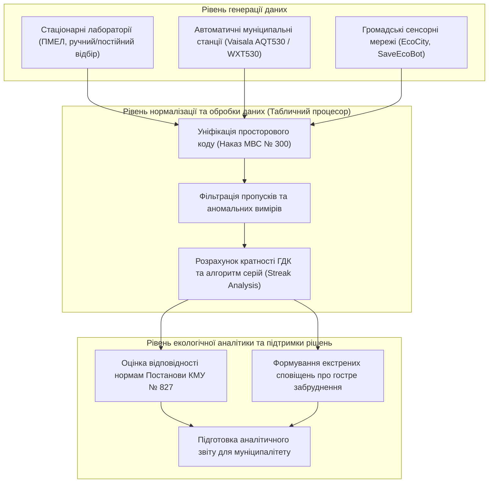

# Лабораторна робота № 1. Дослідження функціональної архітектури та екологічного наповнення відкритих систем моніторингу довкілля

**Мета:** сформувати систему практичних умінь щодо дослідження функціональної організації та інформаційного наповнення відкритих муніципальних і громадських систем моніторингу атмосферного повітря; опанувати методики вибірки, фільтрації та первинної обробки гетерогенних екологічних часових рядів за допомогою табличних процесорів; навчитися проводити розрахунки кратності перевищення гранично допустимих концентрацій (ГДК), виконувати аналіз безперервних серій забруднення (streak-аналіз) та генерувати просторово-ідентифікаційні коди спостережних пунктів відповідно до вимог вітчизняного законодавства й міжнародних нормативів.

---

## Короткі теоретичні відомості

Сучасна система спостереження за станом атмосферного повітря в урбанізованих екосистемах базується на функціональній інтеграції постів різного підпорядкування та приладового оснащення. Відповідно до вимог Постанови Кабінету Міністрів України № 827 «Деякі питання здійснення державного моніторингу в галузі охорони атмосферного повітря» та директиви Європейського Союзу 2024/2881/EC (Ambient Air Quality Directive), управління якістю повітря передбачає перехід від пасивного накопичення первинних показників до структурованого аналізу ризиків у режимі реального часу.

Інформаційно-аналітична інфраструктура муніципального рівня поєднує декілька взаємодоповнюючих контурів спостереження, які відрізняються періодичністю вимірювань, точністю сенсорів та протоколами передачі даних.



Для стандартизації розподіленої мережі на території України Наказом Міністерства внутрішніх справ України № 300 регламентовано правила обов'язкового кодування постів спостереження. З метою подолання просторової невизначеності базовий регламент доповнюється геокоординатною прив'язкою, утворюючи уніфікований код спостережного пункту фіксованої структури:

$$\text{Code} = \langle \text{REG} \rangle - \langle \text{LAT} \rangle - \langle \text{LON} \rangle - \langle \text{ORG} \rangle$$

де елемент $\text{REG}$ є двозначним цифровим кодом області (наприклад, 17 для Полтавської області); фрагменти $\text{LAT}$ та $\text{LON}$ позначають відповідно географічну широту та довготу розташування поста у десяткових градусах, нормалізовані до чотирьох знаків після коми (точність просторового позиціонування на місцевості сягає до 10 метрів); компонент $\text{ORG}$ містить літерну абревіатуру балансоутримувача обладнання (наприклад, `KRNU_ECOL` або `NDZ_KREMEN`).

Математична формалізація процесу оцінювання забрудненості атмосферного повітря базується на представленні вихідного масиву спостережень у вигляді багатовимірної числової матриці:

$$X = \{x_{i,j,t}\}, \quad i \in \{1, \ldots, N\}, \; j \in \{1, \ldots, M\}, \; t \in \{1, \ldots, T\}$$

де індекс $i$ відповідає номеру вимірювального поста, змінна $j$ визначає контрольовану хімічну речовину або фізичний параметр, а мітка $t$ відповідає дискретному моменту фіксації вимірювання в часі.

Середня концентрація контрольованої домішки за встановлений розрахунковий період розраховується за формулою:

$$\bar{C}_{ij} = \frac{1}{N_t} \sum_{k=1}^{N_t} C_{ij}(t_k)$$

де змінна $C_{ij}(t_k)$ позначає концентрацію $j$-ї речовини на $i$-му пості у момент часу $t_k$, а величина $N_t$ задає загальну кількість валідних вимірювань за відповідний часовий інтервал.

Для оцінки небезпеки виміряні абсолютні значення переводяться у відносний показник — кратність нормативу гранично допустимої концентрації ($K_{\text{ГДК}}$):

$$K_{\text{ГДК}, j} = \frac{x_{i,j,t}}{G_j}$$

де величина $x_{i,j,t}$ задає фактичну концентрацію речовини у міліграмах на метр кубічний ($\text{мг/м}^3$), а параметр $G_j$ є офіційно встановленим нормативом середньодобової або максимально разової гранично допустимої концентрації для цієї речовини.

Факт порушення гігієнічного нормативу фіксується за допомогою дискретної бінарної індикаторної функції:

$$P_{i,j,t} = \begin{cases} 1, & \text{якщо } x_{i,j,t} > G_j \\ 0, & \text{якщо } x_{i,j,t} \le G_j \end{cases}$$

Сумарна кількість зареєстрованих перевищень нормативу на обраному часовому інтервалі визначається виразом:

$$C_{i,j} = \sum_{t=1}^{T} P_{i,j,t}$$

З метою своєчасного реагування на тривалі небезпечні техногенні викиди у системах екологічного моніторингу реалізується алгоритм підрахунку безперервних послідовностей перевищень нормативів (streak analysis). Відповідно до положень Постанови КМУ № 827, фіксація підвищених концентрацій протягом трьох поспіль годин і більше кваліфікується як критична ситуація, яка потребує інформування служб оперативного реагування та верифікації вимірювань сертифікованою пересувною лабораторією.

Розрахункові значення гранично допустимих концентрацій забруднюючих речовин в атмосферному повітрі населених місць, що використовуються для проведення аналізу, наведено у наступній нормативній таблиці.

| Назва забруднюючої речовини | Хімічна формула / маркер | ГДК максимально разова, $\text{мг/м}^3$ | ГДК середньодобова, $\text{мг/м}^3$ | Клас небезпеки речовини |
| :--- | :--- | :--- | :--- | :--- |
| Недиференційований пил (завислі речовини) | $\text{Dust}$ / $\text{TSP}$ | 0,500 | 0,150 | 3 (помірно небезпечні) |
| Тверді частинки фракції PM10 | $\text{PM}_{10}$ | 0,150 | 0,050 | 3 (помірно небезпечні) |
| Тверді частинки фракції PM2.5 | $\text{PM}_{2.5}$ | 0,075 | 0,025 | 3 (помірно небезпечні) |
| Діоксид азоту | $\text{NO}_2$ | 0,200 | 0,040 | 2 (високонебезпечні) |
| Оксид вуглецю | $\text{CO}$ | 5,000 | 3,000 | 4 (малонебезпечні) |
| Діоксид сірки | $\text{SO}_2$ | 0,500 | 0,050 | 3 (помірно небезпечні) |
| Формальдегід | $\text{HCHO}$ | 0,035 | 0,003 | 2 (високонебезпечні) |
| Сірководень | $\text{H}_2\text{S}$ | 0,008 | 0,008 | 2 (високонебезпечні) |
| Фенол | $\text{C}_6\text{H}_5\text{OH}$ | 0,010 | 0,003 | 2 (високонебезпечні) |
| Сажа | $\text{C}$ | 0,150 | 0,050 | 3 (помірно небезпечні) |

> **ВАЖЛИВО:** Перевищення середньодобового нормативу ГДК свідчить про системну токсикологічну дію на урбоекосистему і хронічний ризик для здоров'я населення, тоді як перевищення максимально разового нормативу вказує на гострий залповий викид промислового підприємства або екстремальне транспортне навантаження.

> **ПРАКТИЧНИЙ ЯКІР:** У промисловому вузлі міста Кременчук концентрації формальдегіду та діоксиду азоту, зафіксовані стаціонарними лабораторіями комунального підприємства «НДЦ», у теплі періоди року регулярно сягають від 1,5 до 3,5 кратностей середньодобової ГДК через взаємодію викидів автотранспорту вздовж автошляхів та фотохімічних процесів перетворення органічних речовин.

> **ТИПОВА ПОМИЛКА:** Порівняння короткострокових (погодинних чи 20-хвилинних) значень вимірювань зі значеннями середньодобових нормативів без попереднього усереднення або пряме зіставлення добових агрегатів із максимально разовими лімітами. Для дискретних погодинних даних первинний скринінг екстремальних емісій повинен спиратися на значення ГДК максимально разової ($G_{\text{м.р.}}$), а оцінка загального фону за добу — на нормативи ГДК середньодобової ($G_{\text{с.д.}}$).

---

## Порядок виконання роботи

Для виконання завдань використовується файл первинних даних `air_monitoring_data.xlsx`, наданий викладачем. Усі розрахунки та аналітичні процедури виконуються засобами табличного процесора Microsoft Excel або Google Таблиці без застосування спеціальних засобів програмування.

### Етап 1. Імпорт, перевірка повноти та первинна підготовка даних
На цьому етапі здобувач обирає аркуш або діапазон даних згідно з номером свого індивідуального варіанта, створює копію робочого листа для аналізу та перевіряє цілісність структури таблиці. Необхідно проконтролювати формат стовпця з часовими мітками, забезпечивши відображення календарної дати й точного часу у форматі `ДД.ММ.РРРР ГГ:ХХ`. За наявності порожніх клітинок або некоректних текстових маркерів помилок обладнання (наприклад, `null`, `NaN`, `-999`) слід виключити такі рядки з подальшого розрахунку або зафіксувати їхню кількість для оцінки загального відсотка браку даних.

### Етап 2. Формування уніфікованого просторового ідентифікатора поста
Використовуючи значення географічної широти та довготи поста спостереження, наведені у паспортній частині вихідного файлу, необхідно згенерувати стандартизований просторовий код об'єкта. Генерація здійснюється в окремій комірці за допомогою стандартної текстової функції зчеплення рядків:
```excel
=ЗЦЕПИТИ(REG; "-"; ТЕКСТ(LAT; "0,0000"); "-"; ТЕКСТ(LON; "0,0000"); "-"; ORG)
```
або у сучасній версії табличного процесора:
```excel
=CONCAT(REG; "-"; TEXT(LAT; "0.0000"); "-"; TEXT(LON; "0.0000"); "-"; ORG)
```
Отриманий ідентифікатор вноситься до заголовка розрахункового аркуша.

### Етап 3. Розрахунок аналітичних показників забруднення та кратності нормативів
У робочу таблицю додаються розрахункові стовпці для кожного досліджуваного полютанта. За допомогою стандартних математичних операторів для кожного рядка вимірювань обчислюється кратність ГДК відносно нормативу максимально разової концентрації:
```excel
=B2 / Посилання_на_ГДК_речовини
```
У сусідньому стовпці реалізується бінарний логічний індикатор перевищення допустимого порогу за допомогою умовної функції:
```excel
=ЯКЩО(B2 > Посилання_на_ГДК_речовини; 1; 0)
```
Після заповнення розрахункових стовпців для всього масиву рядків у підсумковому блоці таблиці обчислюються: середня арифметична концентрація домішки за аналізований період (функція `=AVERAGE`), максимальне зареєстроване значення (функція `=MAX`), мінімальне значення (функція `=MIN`), а також сумарна кількість зафіксованих перевищень нормативу (функція `=SUM` за стовпцем бінарного індикатора).

### Етап 4. Алгоритмічний streak-аналіз неперервних серій перевищень
Для виявлення небезпечних техногенних інцидентів організовується динамічний підрахунок тривалості безперервного порушення граничних нормативів. В окремому розрахунковому стовпці `Streak_Count` для першого рядка даних вводиться формула:
```excel
=ЯКЩО(C2=1; 1; 0)
```
Для всіх наступних рядків (починаючи з третього) вводиться рекурентна функція накопичення тривалості порушення, яка враховує стан попереднього моменту часу:
```excel
=ЯКЩО(C3=1; E2+1; 0)
```
де клітинка `C3` позначає бінарний індикатор перевищення в поточному рядку, а клітинка `E2` відповідає значенню лічильника неперервної серії у попередній часовий момент. За результатами розрахунку за допомогою функції `=COUNTIF(E:E; ">=3")` визначається кількість часових інтервалів, під час яких спостерігалася критична неперервна загазованість атмосфери тривалістю три години поспіль і більше.

### Етап 5. Графічна візуалізація та картографічне зіставлення
За отриманими числовими рядами будується спільний графік зміни концентрації забруднюючої речовини в часі. На графік обов'язково наноситься горизонтальна сигнальна лінія червоного кольору, яка відповідає рівню встановленого нормативу ГДК. Для часових інтервалів, де зареєстровано критичні послідовні серії перевищень нормативів, застосовується виділення точок маркувальними значками контрастного кольору.

### Етап 6. Аналітична оцінка результатів та формування рекомендацій
На підставі співвідношення фактичних концентрацій із нормативами Постанови КМУ № 827 здобувач формулює аргументований експертний висновок. У висновку зазначається, чи є виявлене забруднення результатом короткочасного залпового викиду, чи воно відображає стійку тенденцію високого антропогенного навантаження; визначаються ймовірні джерела емісій (автотранспортний потік, промисловий майданчик чи енергетичний об'єкт) та пропонуються заходи оперативного реагування.

---

## Індивідуальні завдання

Здобувач обирає набір вихідних параметрів відповідно до свого варіанта за наведеною таблицею. Потім у файлі `air_monitoring_data.xlsx` він знаходить відповідну вкладку досліджуваного поста і проводить повний аналітичний цикл для двох зазначених забруднюючих речовин за вказаний період.

| Варіант | Назва поста спостереження | Тип пункту спостереження | Географічні координати поста | Досліджувані речовини | Аналізований період |
| :---: | :--- | :--- | :---: | :--- | :---: |
| 1 | Пост № 1, м. Кременчук (вул. Молодіжна, 9) | Стаціонарний муніципальний пост | 49.1124° пн. ш., 33.4312° сх. д. | $\text{Dust}$, $\text{NO}_2$ | 01.07.2023 – 07.07.2023 |
| 2 | Пост № 2, м. Кременчук (вул. Лікаря Богаєвського) | Стаціонарний муніципальний пост | 49.0782° пн. ш., 33.4285° сх. д. | $\text{CO}$, $\text{HCHO}$ | 08.07.2023 – 14.07.2023 |
| 3 | Пост № 4, м. Кременчук (вул. Шевченка, 22/30) | Стаціонарний муніципальний пост | 49.0658° пн. ш., 33.4154° сх. д. | $\text{Dust}$, $\text{SO}_2$ | 15.07.2023 – 21.07.2023 |
| 4 | Пост № 5, м. Кременчук (вул. І. Приходька, 89) | Стаціонарний муніципальний пост | 49.0345° пн. ш., 33.4471° сх. д. | $\text{NO}_2$, $\text{CO}$ | 22.07.2023 – 28.07.2023 |
| 5 | Станція Vaisala T3950716 (Північний промвузол) | Автоматична промислова станція | 49.1561° пн. ш., 33.4518° сх. д. | $\text{PM}_{10}$, $\text{SO}_2$ | 01.08.2023 – 07.08.2023 |
| 6 | Станція Vaisala T3950713 (Район «Фаворит») | Автоматична муніципальна станція | 49.0815° пн. ш., 33.4392° сх. д. | $\text{PM}_{2.5}$, $\text{NO}_2$ | 08.08.2023 – 14.08.2023 |
| 7 | Станція Vaisala V0440346 (Гімназія № 26) | Автоматична станція житлової зони | 49.0987° пн. ш., 33.4206° сх. д. | $\text{CO}$, $\text{H}_2\text{S}$ | 15.08.2023 – 21.08.2023 |
| 8 | Станція EcoCity 1748 (вул. Соборна) | Індикативна станція громадської мережі | 49.0682° пн. ш., 33.4091° сх. д. | $\text{PM}_{2.5}$, $\text{HCHO}$ | 22.08.2023 – 28.08.2023 |
| 9 | Станція EcoCity 1756 (Крюківський міст) | Мобільний/індикативний пост на автошляху | 49.0512° пн. ш., 33.4298° сх. д. | $\text{NO}_2$, $\text{C}$ (сажа) | 01.09.2023 – 07.09.2023 |
| 10 | Пост № 1, м. Горішні Плавні (вул. Добровольського) | Стаціонарний регіональний пост | 49.0118° пн. ш., 33.6425° сх. д. | $\text{Dust}$, $\text{SO}_2$ | 08.09.2023 – 14.09.2023 |

---

## Вимоги до змісту звіту

Звіт оформлюється українською мовою в електронному вигляді у форматі PDF або DOCX та подається на перевірку викладачу разом із розрахунковим файлом електронної таблиці. 

Структура звіту повинна містити такі обов'язкові розділи:
1. **Титульна сторінка:** містить найменування навчального закладу, інституту, випускової кафедри, назву навчальної дисципліни, тему лабораторної роботи, номер варіанта індивідуального завдання, а також прізвище, ініціали та навчальну групу здобувача.
2. **Мета роботи:** чітке формулювання дослідницьких і розрахункових цілей відповідно до наданих методичних вказівок.
3. **Порядок виконання роботи:** структурований покроковий опис виконаних обчислювальних дій в електронних таблицях із зазначенням використаних стандартних функцій, математичних виразів та параметрів фільтрації вихідного масиву.
4. **Результати розрахунків:**
   * Згенерований уніфікований код поста спостереження з розшифруванням кожного блоку ідентифікатора.
   * Зведена підсумкова таблиця статистичних показників (середнє арифметичне, мінімальне та максимальне значення, кратність ГДК, сумарна кількість випадків перевищень нормативу, кількість зафіксованих небезпечних серій тривалістю $\ge 3$ годин) для обох досліджуваних домішок.
   * Графічні діаграми динаміки концентрацій речовин із нанесеними горизонтальними лініями нормативів ГДК та виділеними точками небезпечних послідовних перевищень.
5. **Аналітичні висновки:** фахове екологічне трактування отриманих результатів із порівняльним аналізом ступеня небезпеки виявлених концентрацій згідно з Постановою КМУ № 827, визначенням вірогідних джерел забруднення та пропозиціями щодо заходів оперативного оповіщення чи оптимізації моніторингової мережі.
6. **Відповіді на контрольні запитання:** розгорнуті письмові відповіді на всі контрольні запитання, наведені у розділі 5.

---

## 5 Контрольні запитання

1. Які принципові відмінності існують між функціональними завданнями державних стаціонарних постів спостереження, автоматичних муніципальних комплексів типу Vaisala та індикативних станцій громадського моніторингу типу EcoCity?
2. Яким чином формується уніфікований 18-значний просторовий код пункту спостереження за якістю повітря відповідно до вимог вітчизняних нормативних документів, та яку функціональну роль відіграє зазначення географічних координат із точністю до чотирьох знаків після коми?
3. У чому полягає токсикологічна та нормативна різниця між показниками гранично допустимої концентрації максимально разової ($G_{\text{м.р.}}$) та середньодобової ($G_{\text{с.д.}}$), і які правила їх застосування слід використовувати під час аналізу погодинних рядів моніторингу?
4. Опишіть алгоритм виявлення безперервних серій перевищень нормативів (streak-аналіз). Чому безперервна фіксація підвищених концентрацій газових домішок протягом трьох годин поспіль розглядається як критична екологічна подія в контексті Постанови КМУ № 827?
5. Які переваги та обмеження має використання табличних процесорів (Microsoft Excel, Google Таблиці) на етапі первинної підготовки, фільтрації та валідації екологічних даних великого обсягу у порівнянні зі спеціалізованими мовами програмування?