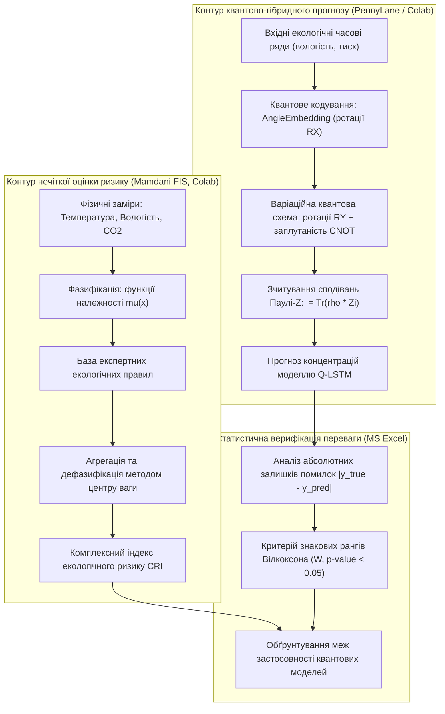

# Лабораторна робота № 10. Застосування алгоритмів нечіткої логіки та квантово-гібридних шаблонів для оцінки екологічних ризиків і якості мікроклімату приміщень

**Мета:** сформувати систему практичних умінь щодо інтелектуального аналізу екологічних ризиків в умовах невизначеності вхідної інформації за допомогою систем нечіткої логіки та новітніх квантово-гібридних обчислювальних технологій; опанувати процедуру побудови систем нечіткого виводу Мамдані для комплексної оцінки якості мікроклімату приміщень і урбанізованого середовища в інтерактивному блокноті Google Colab; навчитися проводити порівняльний аналіз (бенчмаркінг) точності квантово-гібридних архітектур (Q-LSTM, Q-Transformer) та їхніх класичних аналогів на реальних часових рядах моніторингу; опанувати розрахунок непараметричного критерію знакових рангів Вілкоксона для оцінки статистичної значущості квантової переваги за допомогою табличного процесора Microsoft Excel або Google Таблиці.

---

## Короткі теоретичні відомості

Оцінка екологічної безпеки урбоекосистем та виробничих приміщень часто спирається на параметри, що характеризуються розмитими межами між безпечним, допустимим та загрозливим станами. Формалізація таких слабкоструктурованих характеристик класичними методами булевої логіки («так / ні») призводить до втрати чутливості системи моніторингу поблизу нормативних меж. Подолання цієї проблеми забезпечується апаратом теорії нечітких множин та системами нечіткого логічного виводу (Fuzzy Inference Systems, FIS) за алгоритмом Мамдані.

Процес нечіткого моделювання складається з чотирьох послідовних етапів. На етапі фазифікації кожне точне числове значення фізичного показника (наприклад, температури $T$, відносної вологості $H$ чи концентрації вуглекислого газу $\text{CO}_2$) трансформується у вектор ступенів належності до лінгвістичних термів за допомогою трикутних або трапецієподібних функцій належності $\mu_A(x) \in [0; \, 1]$. На етапі логічного виводу до фазифікованих змінних застосовується база експертних продукційних правил виду «ЯКЩО $T$ висока І $H$ висока, ТО ризик критичний». На етапі агрегації формується підсумкова підрізана фігура результуючої функції належності за оператором максимуму. На етапі дефазифікації отримане нечітке значення переводиться у чітке число комплексного індексу екологічного ризику (Comprehensive Risk Index, CRI) методом центру ваги (Centroid method):

$$y^* = \frac{\int y \cdot \mu_{\text{agg}}(y) \, dy}{\int \mu_{\text{agg}}(y) \, dy}$$

де змінна $y$ позначає значення вихідного індексу ризику за шкалою від 0 до 100 пунктів; функція $\mu_{\text{agg}}(y)$ визначає результуючу агреговану функцію належності виходу системи.



Для прецизійного прогнозування майбутніх значень екологічних параметрів у сучасних системах застосовується парадигма квантового машинного навчання (Quantum Machine Learning, QML). На етапі поточного розвитку квантових технологій (епоха шумових квантових процесорів проміжного масштабу, NISQ) найбільш перспективними є квантово-гібридні архітектури, де класична нейромережа (LSTM або Transformer) доповнюється варіаційною квантовою схемою (Variational Quantum Circuit, VQC), що виступає як спеціалізований копроцесор оптимізації ознакового простору.

У квантово-гібридній моделі Q-LSTM нормалізований класичний вектор екологічних ознак $\mathbf{x} \in [0; \, 1]^n$ відображається у квантовий стан за допомогою ротаційного кодування (AngleEmbedding), де значення параметрів задають кути обертання квантових вентилів:

$$\text{qml.RX}(x_i, \text{wires} = i), \quad i \in \{1, \ldots, n_{\text{qubits}}\}$$

Далі квантовий стан перетворюється варіаційними шарами, що містять параметризовані ротації навколо осі $Y$ ($\text{RY}(\theta)$) та фіксовані вентилі контрольованого заперечення CNOT для створення квантової заплутаності між кубітами. Зчитування результату здійснюється шляхом вимірювання математичного сподівання оператора Паулі-Z для кожного кубіта:

$$\langle Z_i \rangle = \text{Tr}\big( \rho(\mathbf{x}, \mathbf{w}) \cdot Z_i \big)$$

де матриця $\rho$ описує еволюціонувавший квантовий стан системи, а вектор $\mathbf{w}$ містить оптимізовані ваги квантової схеми. Підсумковий прогноз формується усередненням квантових сподівань або їх пропусканням через лінійний повнозв'язний шар:

$$\hat{y}_t = \frac{1}{Q} \sum_{i=1}^{Q} \langle Z_i \rangle$$

Емпіричні дослідження на масивах моніторингу міста Кременчук виявили виражену параметричну дихотомію ефективності квантово-гібридних моделей у порівнянні з класичними аналогами. Для стабільних циклічних параметрів із високою автокореляцією першого лагу ($\text{ACF}(1) > 0,80$), таких як атмосферний тиск та вологість повітря, квантові моделі демонструють істотне зменшення середньоквадратичної похибки (зниження MSE сягає від 19,39% до 74,74%). Це пояснюється здатністю варіаційних квантових схем діяти як ядерні методи з нескінченновимірним гільбертовим простором, що забезпечує лінійну подільність нелінійних взаємозв'язків без ризику перенавчання на малому числі кубітів. Водночас для параметрів із надзвичайно високою стохастичною волатильністю (температура повітря та концентрації оксиду вуглецю) квантові моделі суттєво програють класичним алгоритмам AutoARIMA (похибка зростає на 60–314%) внаслідок явища «безплідного плато» (Barren Plateau) та перенавчання на апаратному шумі.

Для наукового доведення квантової переваги використовується непараметричний парний критерій знакових рангів Вілкоксона, який перевіряє нульову гіпотезу про те, що медіана різниць абсолютних помилок між класичною моделлю ($e_{\text{cl}} = |y - \hat{y}_{\text{cl}}|$) та квантовою моделлю ($e_{\text{qu}} = |y - \hat{y}_{\text{qu}}|$) дорівнює нулю. Статистика тесту $W$ визначається виразом:

$$W = \min(W^+, W^-)$$

де величини $W^+$ та $W^-$ позначають відповідно суми рангів додатних і від'ємних різниць похибок. Якщо розрахований рівень значущості $p\text{-value} < 0,05$, перевага моделі визнається статистично достовірною.

Порівняльні характеристики точності базових моделей на тестових масивах Кременчуцької агломерації наведено у наступній аналітичній таблиці.

| Параметр середовища | Пункт моніторингу | Найкраща класична модель | MSE класичної моделі | Найкраща квантова модель | MSE квантової моделі | Відносна зміна похибки $\Delta \text{MSE}$ | Статистична значущість (Wilcoxon) |
| :--- | :--- | :--- | :---: | :--- | :---: | :---: | :---: |
| Відносна вологість | Промвузол | LSTM | 120,33 | Q-LSTM | 65,02 | Зниження на 45,96% | $p < 0,05$ (значуща) |
| Атмосферний тиск | Промвузол | AutoARIMA | 4,25 | Q-Transformer | 1,07 | Зниження на 74,74% | $p < 0,05$ (значуща) |
| Діоксид азоту ($\text{NO}_2$) | Район «Фаворит» | Theta | 0,00035 | Q-CNN | 0,00019 | Зниження на 46,46% | $p < 0,05$ (значуща) |
| Оксид вуглецю ($\text{CO}$) | Гімназія № 26 | AutoARIMA | 0,00510 | Q-AutoARIMA | 0,01260 | Зростання на 147,0% | $p > 0,05$ (незначуща) |
| Температура повітря | Гімназія № 26 | AutoARIMA | 12,89 | Q-TBATS | 53,45 | Зростання на 314,6% | $p < 0,05$ (класична краща) |

> **ВАЖЛИВО:** Застосування квантово-гібридних нейромереж є науково виправданим виключно за наявності складної нелінійної гармонійної структури у вихідних даних моніторингу за обмеженого обсягу навчальної вибірки. Для простих, зашумлених або високодисперсних часових рядів принцип статистичної простоти («Бритва Оккама») забезпечує перевагу класичних моделей лінійної авторегресії (AutoARIMA).

> **ПРАКТИЧНИЙ ЯКІР:** При моніторингу виробничого мікроклімату на підприємствах Кременчука впровадження нечіткої експертної системи Мамдані дозволило автоматизувати управління припливно-витяжною вентиляцією, знижуючи ризик теплового та токсичного стресу працівників у цехах без необхідності встановлення надто дорогих датчиків специфічних газів.

> **ТИПОВА ПОМИЛКА:** Спроба оцінювати перевагу моделі лише за одиничним значенням середньоквадратичної похибки без проведення непараметричних статистичних тестів на розподілі залишків. Через аномальні поодинокі викиди середнє значення похибки може бути викривлене, що призводить до помилкового висновку про перевагу моделі, яка насправді генерує більшу кількість значних відхилень у повсякденних режимах роботи.

---

## Порядок виконання роботи

Для виконання завдань використовується вхідний файл `quantum_classical_forecasting_benchmark.xlsx`, наданий викладачем. Розрахунок нечіткого виводу та запуск квантових прогнозів здійснюються у хмарному блокноті Google Colab за допомогою графічних форм, а статистична перевірка похибок за тестом Вілкоксона — у табличному процесорі Microsoft Excel або Google Таблиці.

### Етап 1. Дослідження системи нечіткого виводу Мамдані в Google Colab
Здобувач відкриває інтерактивний блокнот Google Colab у розділі «Fuzzy Microclimate Evaluation». У графічній панелі інтерфейсу аналізуються трикутні та трапецієподібні функції належності для вхідних показників мікроклімату: температури (терми «Холодно», «Комфортно», «Жарко»), вологості («Сухо», «Норма», «Волого») та вмісту вуглекислого газу («Чисто», «Забруднено», «Критично»). Здобувач переглядає вбудовану базу експертних продукційних правил.

### Етап 2. Розрахунок комплексного індексу ризику CRI за різними сценаріями
За допомогою інтерактивних повзунків здобувач по черзі виставляє комбінації вхідних параметрів відповідно до свого варіанта індивідуального завдання (наприклад, $T = 28\text{ °C}$, вологість 75%, $\text{CO}_2 = 1200\text{ ppm}$). Програма виконує операції фазифікації, знаходження мінімумів у логічних зв'язках, агрегацію максимальних меж та дефазифікацію за методом центру ваги. Здобувач фіксує розраховане числове значення індексу екологічного ризику $\text{CRI} \in [0; \, 100]$ та згенерований текстовий статус виробничого середовища.

### Етап 3. Запуск квантово-гібридного бенчмаркінгу в Google Colab
У другій секції блокнота здобувач обирає з випадаючого списку часовий ряд екологічного показника згідно з варіантом (наприклад, атмосферний тиск або відносна вологість на станції Північного промвузла) та задає кількість кубітів у схемі ($Q = 4$). Програма виконує прогін попередньо натренованих моделей (класичної LSTM та квантово-гібридної Q-LSTM), формує прогнози на тестовому горизонті та виводить таблицю числових похибок (MSE, MAE, $R^2$), а також розділену скрипкову діаграму (split violin plot) щільності розподілу залишків.

### Етап 4. Перенесення масиву залишків у табличний процесор MS Excel
Масив парних абсолютних похибок для тестових точок копіюється з блокнота Colab до аркуша табличного процесора MS Excel. Формуються стовпці: фактичне значення $y_t$, прогноз класичної моделі $\hat{y}_{\text{cl}}$, прогноз квантової моделі $\hat{y}_{\text{qu}}$, а також абсолютні похибки $e_{\text{cl}} = |y_t - \hat{y}_{\text{cl}}|$ та $e_{\text{qu}} = |y_t - \hat{y}_{\text{qu}}|$.

### Етап 5. Реалізація розрахунку критерію знакових рангів Вілкоксона
В електронній таблиці створюється стовпець попарних різниць похибок $\Delta e_t = e_{\text{cl}, t} - e_{\text{qu}, t}$. Рядки з нульовою різницею виключаються. Для абсолютних значень різниць $|\Delta e_t|$ за допомогою стандартної функції ранжування присвоюються ранги:
```excel
=RANK.AVG(ABS(D2); ABS($D$2:$D$21); 1)
```
Окремо підсумовуються ранги для позитивних різниць (де квантова модель була точнішою, $W^+$) та для негативних різниць (де точнішою була класична модель, $W^-$). Менше з двох значень визначає тестову статистику $W$. Здобувач зіставляє отримане значення $W$ із табличним критичним порогом для заданого обсягу вибірки при рівні значущості $\alpha = 0,05$.

### Етап 6. Порівняльний аналіз результатів та формування висновків
Здобувач зіставляє форму скрипкових діаграм похибок (лептокуртичний гострий розподіл біля нуля свідчить про високу точність і надійність) та результати тесту Вілкоксона. Формулюється обґрунтований науковий висновок про те, чи підтверджується наявність квантової переваги для дослідженого екологічного параметра, та розкриваються фізичні причини поведінки моделі.

---

## Індивідуальні завдання

Здобувач обирає свій варіант за наведеною таблицею, вносить вхідні параметри мікроклімату до нечіткої системи, проводить квантово-гібридне тестування в блокноті Google Colab та виконує статистичний тест у MS Excel.

| Варіант | Станція / об'єкт моніторингу | Досліджуваний часовий ряд | Пара порівнюваних моделей | Тестовий горизонт | Сценарій мікроклімату $(T, H, \text{CO}_2)$ |
| :---: | :--- | :--- | :--- | :---: | :--- |
| 1 | Станція Vaisala T3950716 (Промвузол) | Відносна вологість (%) | LSTM проти Q-LSTM | 7 місяців | $T = 32\text{ °C}, H = 80\%, \text{CO}_2 = 1400\text{ ppm}$ |
| 2 | Станція Vaisala T3950716 (Промвузол) | Атмосферний тиск (кПа) | AutoARIMA проти Q-Transformer | 7 місяців | $T = 16\text{ °C}, H = 40\%, \text{CO}_2 = 600\text{ ppm}$ |
| 3 | Станція Vaisala T3950713 (Район «Фаворит») | Діоксид азоту ($\text{NO}_2$) | CNN проти Q-CNN | 7 місяців | $T = 24\text{ °C}, H = 55\%, \text{CO}_2 = 900\text{ ppm}$ |
| 4 | Станція Vaisala T3950713 (Район «Фаворит») | Відносна вологість (%) | MLP проти Q-Transformer | 7 місяців | $T = 29\text{ °C}, H = 70\%, \text{CO}_2 = 1100\text{ ppm}$ |
| 5 | Станція Vaisala V0440346 (Гімназія № 26) | Оксид вуглецю ($\text{CO}$) | AutoARIMA проти Q-AutoARIMA | 7 місяців | $T = 20\text{ °C}, H = 50\%, \text{CO}_2 = 800\text{ ppm}$ |
| 6 | Станція Vaisala V0440346 (Гімназія № 26) | Температура повітря (°C) | AutoARIMA проти Q-TBATS | 7 місяців | $T = 12\text{ °C}, H = 85\%, \text{CO}_2 = 1300\text{ ppm}$ |
| 7 | Станція EcoCity 1748 (Центр міста) | Дрібнодисперсний пил PM2.5 | GRU проти Q-GRU | 7 місяців | $T = 26\text{ °C}, H = 60\%, \text{CO}_2 = 1000\text{ ppm}$ |
| 8 | Станція EcoCity 1756 (Крюківський міст) | Діоксид азоту ($\text{NO}_2$) | Transformer проти Q-Transformer | 7 місяців | $T = 35\text{ °C}, H = 45\%, \text{CO}_2 = 1600\text{ ppm}$ |
| 9 | Лабораторія екологічного контролю | Концентрація $\text{CO}_2$ (приміщення) | LSTM проти Q-LSTM | 7 місяців | $T = 22\text{ °C}, H = 50\%, \text{CO}_2 = 750\text{ ppm}$ |
| 10 | Регіональний пост (Горішні Плавні) | Атмосферний тиск (кПа) | AutoARIMA проти Q-TBATS | 7 місяців | $T = 18\text{ °C}, H = 65\%, \text{CO}_2 = 850\text{ ppm}$ |

---

## Вимоги до змісту звіту

Звіт оформлюється в електронному вигляді у форматі PDF або DOCX та подається на перевірку викладачу разом із розрахунковою таблицею у форматі XLSX.

Структура звіту повинна містити такі обов'язкові розділи:
1. **Титульна сторінка:** містить найменування навчального закладу, інституту, випускової кафедри, назву навчальної дисципліни, тему лабораторної роботи, номер варіанта індивідуального завдання, а також прізвище, ініціали та навчальну групу здобувача.
2. **Мета роботи:** чітке формулювання дослідницьких і розрахункових цілей відповідно до наданих методичних вказівок.
3. **Порядок виконання роботи:** структурований опис кроків налаштування системи нечіткої логіки та проведення квантово-гібридного бенчмаркінгу з описом формул розрахунку тесту Вілкоксона.
4. **Результати розрахунків та візуалізація:**
   * Графіки вхідних функцій належності та поверхня нечіткого виводу (Fuzzy Surface), отримані в середовищі Google Colab.
   * Розраховане точне числове значення індексу екологічного ризику $\text{CRI}$ та його фахова інтерпретація для заданого мікрокліматичного сценарію.
   * Зведена таблиця метрик точності (MSE, MAE, $R^2$) для класичної та квантово-гібридної моделей прогнозування за досліджуваним екологічним параметром.
   * Скриншот розділеної скрипкової діаграми (split violin plot) щільності розподілу залишків класичної та квантової архітектур.
   * Розрахункова таблиця критерію знакових рангів Вілкоксона в MS Excel із визначеними сумами рангів $W^+, W^-$ та підсумковою тестовою статистикою $W$.
5. **Аналітичні висновки:** фахове екологічне трактування отриманих результатів; аналіз придатності нечіткої логіки для оцінки комфорту середовища; детальне фізико-математичне пояснення наявності чи відсутності квантової переваги для досліджуваного параметра (вплив спектральних характеристик ряду, наявності циклічності та рівня апаратного шуму).
6. **Відповіді на контрольні запитання:** розгорнуті письмові відповіді на всі контрольні запитання, наведені у розділі 5.

---

## 5 Контрольні запитання

1. У чому полягає системна перевага застосування апарату нечіткої логіки та алгоритму Мамдані для оцінки комплексних екологічних ризиків у порівнянні з класичними пороговими правилами булевої логіки?
2. Опишіть призначення етапів фазифікації, агрегації правил та дефазифікації методом центру ваги (Centroid method) у системах інтелектуального моніторингу виробничого мікроклімату.
3. Яким чином варіаційні квантові схеми (VQC) інтегруються у класичні рекурентні нейронні мережі (створення архітектури Q-LSTM), та яку функцію виконує квантове ротаційне кодування AngleEmbedding?
4. Чому на стабільних гармонійних екологічних часових рядах (атмосферний тиск, вологість) квантово-гібридні моделі демонструють значну перевагу у точності, а на високодисперсних рядах температури та оксиду вуглецю зазнають деградації похибки?
5. З якою метою при порівнянні точності екологічних прогнозних моделей застосовується непараметричний критерій знакових рангів Вілкоксона, і чому використання класичного параметричного t-критерію Стьюдента часто є некоректним для екологічних вибірок залишків?