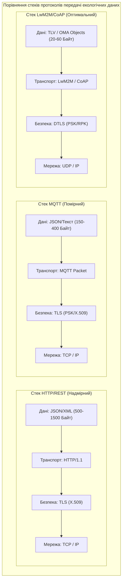

# Лабораторна робота № 2. Конфігурування каналу передачі даних від IoT-станцій екологічного моніторингу на основі емульованих сенсорів та протоколу MQTT/LwM2M

**Мета:** дослідити мережеву архітектуру та протокольні механізми функціонування розподілених систем Інтернету речей (IoT) для задач моніторингу атмосферного повітря; опанувати аналітичні методи оцінки мережевих накладних витрат під час передачі екологічної інформації за протоколами LwM2M/CoAP, MQTT та HTTP/REST; навчитися розраховувати енергетичний баланс, середній струм споживання та прогнозований життєвий цикл автономних польових станцій моніторингу залежно від складу сенсорного обладнання і регламенту передачі даних за допомогою табличного процесора Microsoft Excel або Google Таблиці.

---

## Короткі теоретичні відомості

Розгортання муніципальних та локальних мереж екологічного моніторингу передбачає розміщення значної кількості вимірювальних приладів у зонах, де відсутнє підключення до стаціонарної електромережі та дротових каналів зв'язку. Такі автономні вимірювальні вузли комплектуються акумуляторними батареями, сонячними панелями та бездротовими модемами стільникового зв'язку (переважно стандартів LTE Cat-M, NB-IoT або 2G/GPRS). Головним системним обмеженням польових станцій виступає жорсткий компроміс між частотою фіксації екологічних параметрів, обчислювальною стійкістю алгоритмів шифрування та енергетичною автономністю живлення.

Вибір прикладного мережевого протоколу безпосередньо визначає як обсяг трафіку, так і тривалість активної фази радіопередавача. Традиційні протоколи глобальної мережі (зокрема HTTP/REST поверх стека TCP/IP) створюють надмірне інформаційне навантаження через передачу великих текстових службових заголовків та необхідність багаторазового підтвердження встановлення сесії. Протокол MQTT функціонує за моделлю видавець-підписник і зменшує розмір заголовка, проте вимагає постійної підтримки активного TCP-з'єднання, що призводить до швидкого виснаження батареї. Спеціалізований протокол Lightweight M2M (LwM2M), розроблений альянсом OMA, використовує стек CoAP поверх ненадійного протоколу дейтаграм UDP із захистом DTLS. Завдяки ієрархічній бінарній структурі даних «Об'єкт / Екземпляр / Ресурс» (O/I/R), протокол LwM2M забезпечує мінімальні накладні витрати та потребує лише 6–9% оперативної пам'яті контролера.



Для порівняльної оцінки ефективності протоколів передачі телеметрії від автоматичних постів моніторингу використовуються нормативні технічні характеристики інформаційних пакетів, наведені у наступній таблиці.

| Параметр порівняння | Протокол HTTP / REST | Протокол MQTT | Протокол LwM2M / CoAP |
| :--- | :--- | :--- | :--- |
| Транспортний рівень мережі | TCP | TCP | UDP |
| Протокол криптографічного захисту | TLS | TLS | DTLS або OSCORE |
| Середній розмір службового заголовка | 200–800 байт | 2–5 байт | 4–8 байт |
| Формат представлення корисних даних | Текстовий JSON або XML | Текстовий JSON або текст | Бінарний TLV / CBOR або Plain-text |
| Підтримка підтримки зв'язку (Keep-Alive) | Постійне TCP-з'єднання | Регулярні PING-пакети | Режим сну без утримання каналу |
| Частка оперативної пам'яті клієнта (RAM) | 25–40% | 12–18% | 6–9% |
| Придатність до автономного батарейного живлення | Вкрай низька | Середня | Висока |

Енергетичний цикл функціонування будь-якого екологічного IoT-вузла складається з чотирьох послідовних часових фаз. Першою є фаза прогріву та стабілізації вимірювального тракту, під час якої напівпровідникові або електрохімічні сенсори виходять на стабільний робочий режим. Другою є фаза активного аналогово-цифрового перетворення і зчитування інформації контролером. Третьою виступає фаза радіообміну, що включає реєстрацію в мережі, шифрування та передачу пакета. Четвертою, найбільш тривалою фазою, є стан глибокого сну мікроконтролера, під час якого функціонує лише внутрішній таймер реального часу з мінімальним енергоспоживанням.

Сумарний добовий обсяг генерованого мережевого трафіку для обраного протоколу визначається за математичним виразом:

$$V_{\text{day}} = \frac{1440}{T_{\text{period}}} \cdot (S_{\text{payload}} + S_{\text{header}}) \cdot \frac{1}{1024}$$

де параметр $V_{\text{day}}$ вимірюється у кілобайтах за добу, величина $T_{\text{period}}$ задає інтервал передачі даних у хвилинах, число 1440 визначає кількість хвилин у добі, змінна $S_{\text{payload}}$ позначає розмір корисного навантаження вимірювань у байтах, а величина $S_{\text{header}}$ відповідає сумарному розміру мережевих заголовків транспортного та прикладного рівнів.

Середній струм споживання пристрою за один повний робочий цикл обчислюється як зважена сума струмів усіх його активних та пасивних фаз:

$$I_{\text{avg}} = \frac{I_{\text{warmup}} \cdot t_{\text{warmup}} + I_{\text{read}} \cdot t_{\text{read}} + I_{\text{tx}} \cdot t_{\text{tx}} + I_{\text{sleep}} \cdot (t_{\text{cycle}} - t_{\text{warmup}} - t_{\text{read}} - t_{\text{tx}})}{t_{\text{cycle}}}$$

де значення $t_{\text{cycle}} = T_{\text{period}} \cdot 60$ задає загальну тривалість робочого циклу у секундах, параметри $t_{\text{warmup}}, t_{\text{read}}, t_{\text{tx}}$ позначають тривалість фаз прогріву, зчитування та бездротової передачі відповідно, а змінні $I_{\text{warmup}}, I_{\text{read}}, I_{\text{tx}}, I_{\text{sleep}}$ позначають струми споживання електронної схеми у відповідних функціональних режимах у міліамперах.

Прогнозована тривалість автономної роботи польового сенсорного комплексу без підзарядки розраховується за формулою:

$$T_{\text{life}} = \frac{C_{\text{batt}} \cdot \eta_{\text{discharge}}}{I_{\text{avg}} \cdot 24}$$

де параметр $T_{\text{life}}$ позначає прогнозовану кількість діб автономного функціонування, величина $C_{\text{batt}}$ визначає паспортну електричну ємність акумулятора у міліампер-годинах ($\text{мА}\cdot\text{год}$), а коефіцієнт $\eta_{\text{discharge}} \approx 0,80$ враховує ефективну глибину розряду хімічного джерела струму без критичної деградації напруги.

> **ВАЖЛИВО:** Оптичні сенсори твердих частинок (пиломіри PM2.5/PM10) та газоаналізатори з нагрівальними елементами потребують значного струму для виходу на робочий режим (до 150–250 мА). Спроба проводити неперервні вимірювання кожну хвилину скорочує час життя акумулятора міської станції з кількох місяців до 2–3 діб, що робить перехід на адаптивні цикли та енергоефективні протоколи обов'язковою інженерною вимогою.

> **ПРАКТИЧНИЙ ЯКІР:** У муніципальній системі моніторингу Кременчука автоматичні модулі контролю якості повітря використовують передачу даних за протоколом LwM2M у мережі стільникового зв'язку, що дозволяє зменшити споживання оперативної пам'яті контролера до 8% та забезпечити роботу станцій під час віялових відключень електроенергії завдяки буферному акумулятору.

> **ТИПОВА ПОМИЛКА:** Ігнорування енерговитрат на попередній підігрів газових датчиків або неврахування часу встановлення з'єднання модема з базовою станцією стільникового зв'язку під час розрахунку тривалості активної фази. Помилково вважати, що енергія витрачається лише безпосередньо під час передачі кількох байт корисної інформації.

---

## Порядок виконання роботи

Для виконання завдань використовується вхідний файл `iot_monitoring_parameters.xlsx`, наданий викладачем. Усі розрахунки реалізуються засобами електронних таблиць Microsoft Excel або Google Таблиці.

### Етап 1. Ознайомлення з вихідними технічними параметрами станції
Здобувач відкриває аркуш файлу `iot_monitoring_parameters.xlsx`, що відповідає номеру його варіанта. У таблиці фіксуються вихідні дані: тип мікроконтролера, перелік встановлених сенсорних модулів, характеристики акумуляторної батареї, паспортні струми споживання компонентів у різних режимах, а також базовий часовий інтервал опитування.

### Етап 2. Моделювання обсягів мережевого трафіку для трьох протоколів
В електронній таблиці створюється розрахунковий блок для визначення розмірів інформаційного пакета. Для кожного протоколу (HTTP, MQTT, LwM2M) обчислюється сумарний розмір повідомлення, що складається із заданого розміру корисних даних та нормативного заголовка. За допомогою формули добового трафіку здобувач розраховує навантаження на канал зв'язку для чотирьох регламентів опитування: 1 хвилина, 10 хвилин, 20 хвилин та 60 хвилин:
```excel
=(1440 / Часовий_інтервал) * (Розмір_payload + Розмір_заголовка) / 1024
```
За результатами обчислень будується зведена гістограма, яка ілюструє різницю у витратах інтернет-трафіку між протоколами.

### Етап 3. Розрахунок фазового енергоспоживання сенсорного вузла
На новому аркуші таблиці формується модель балансу струмів сенсорного вузла. Здобувач заповнює таблицю струмів для чотирьох функціональних фаз, підсумовуючи струми всіх задіяних модулів:
* У фазі прогріву підсумовуються струм мікроконтролера в активному стані та струм нагрівачів газових сенсорів.
* У фазі зчитування додається струм живлення оптичних сенсорів пилу та аналогово-цифрових перетворювачів.
* У фазі передачі враховується струм пікового випромінювання стільникового або бездротового модема.
* У фазі глибокого сну враховується лише сумарний струм витоку електронної плати та таймера мікроконтролера.

### Етап 4. Розрахунок інтегрального струму споживання та терміну автономності
Використовуючи часові тривалості кожної фази (задані в секундах), здобувач реалізує розрахунок середньогодинного струму споживання $I_{\text{avg}}$ за наведеною у теоретичних відомостях формулою. На основі розрахованого значення $I_{\text{avg}}$ в окремій комірці обчислюється прогнозована тривалість безперервної роботи акумуляторної батареї у добах:
```excel
=(Ємність_АКБ * 0,80) / (I_avg * 24)
```

### Етап 5. Оцінка чутливості життєвого циклу станції до регламенту опитування
Здобувач проводить багатоваріантний розрахунок автономності для п'яти різних часових інтервалів відправки пакетів: 1, 5, 10, 20 та 60 хвилин. За отриманими точками будується нелінійний графік залежності тривалості роботи поста (у добах) від інтервалу передачі даних. На графіку візуально позначається точка екстремального скорочення автономності.

### Етап 6. Порівняльний аналіз енергетичної та трафікової ефективності
На завершальному етапі здобувач аналізує розраховані параметри та обирає найбільш доцільний протокол для муніципальної станції. Формулюється обґрунтований висновок щодо вибору оптимального періоду вимірювань, який забезпечує нормативну репрезентативність екологічних спостережень без надмірного скорочення терміну функціонування акумулятора.

---

## Індивідуальні завдання

Здобувач обирає свій варіант за наведеною нижче таблицею та вибирає з файлу `iot_monitoring_parameters.xlsx` відповідні технічні характеристики обладнання для проведення повного розрахункового циклу.

| Варіант | Модель вимірювального вузла | Мікроконтролерна платформа | Сенсорний пакет вимірювання | Акумуляторна батарея | Базовий період передачі |
| :---: | :--- | :--- | :--- | :--- | :---: |
| 1 | Еко-пост «Пром-1» (Кременчук) | ESP32-WROOM-32E | $\text{MQ135 } (\text{газ}), \text{ PMS7003 } (\text{пил}), \text{ DHT22}$ | Li-Ion 18650, 2600 мА·год, 3,7 В | 10 хв |
| 2 | Станція мікроклімату «Аудиторія» | ESP8266 NodeMCU | $\text{CCS811 } (\text{VOC/eCO}_2), \text{ BME280 } (T, P, H)$ | Li-Pol, 2000 мА·год, 3,7 В | 5 хв |
| 3 | Мобільний комплекс на транспорті | STM32L431 (Low-Power) | $\text{PMS7003 } (\text{пил}), \text{ GPS Neo-6M}, \text{ DHT22}$ | LiFePO4, 3200 мА·год, 3,2 В | 1 хв |
| 4 | Автономний пост «Крюківський міст» | ESP32-WROOM-32E | $\text{MICS-6814 } (\text{NO}_2/\text{CO}), \text{ SDS011}, \text{ BME280}$ | Li-Ion 21700, 4800 мА·год, 3,7 В | 20 хв |
| 5 | Екологічний шлюз «Північний вузол» | PIC32CM5164LS | $\text{AQT530 } (\text{мультигаз}), \text{ WXT530 } (\text{метео})$ | LiFePO4, 6000 мА·год, 6,4 В | 10 хв |
| 6 | Станція спостереження за водоймами | STM32L072 | $\text{Розчинений кисень}, \text{ pH-сенсор}, \text{ DS18B20}$ | Li-Ion 18650, 3000 мА·год, 3,7 В | 30 хв |
| 7 | Диспетчерський пост «Житловий масив» | ESP32-WROOM-32E | $\text{MQ135}, \text{ MQ7 } (\text{CO}), \text{ PMS7003}, \text{ BME280}$ | Li-Ion блок, 5200 мА·год, 3,7 В | 15 хв |
| 8 | Санітарний буфер промислового вузла | NXP LPC55S36 | $\text{SO}_2 \text{ електрохімічний}, \text{ H}_2\text{S}, \text{ DHT22}$ | LiFePO4, 4000 мА·год, 3,2 В | 20 хв |
| 9 | Локальний детектор пилу та шуму | ESP8266 NodeMCU | $\text{SDS011 } (\text{пил}), \text{ Шумомір}, \text{ AM2302}$ | Li-Pol, 2500 мА·год, 3,7 В | 10 хв |
| 10 | Регіональний реперний фоновий пункт | STM32L476 | $\text{AQT530 } (\text{газ}), \text{ BME280}, \text{ Опадомір}$ | LiFePO4, 10000 мА·год, 6,4 В | 60 хв |

---

## Вимоги до змісту звіту

Звіт оформлюється в електронному вигляді у форматі PDF або DOCX та подається на перевірку разом із розрахунковою таблицею у форматі XLSX.

Структура звіту повинна містити такі обов'язкові розділи:
1. **Титульна сторінка:** містить найменування навчального закладу, інституту, випускової кафедри, назву навчальної дисципліни, тему лабораторної роботи, номер варіанта індивідуального завдання, а також прізвище, ініціали та навчальну групу здобувача.
2. **Мета роботи:** чітке формулювання дослідницьких і розрахункових цілей відповідно до наданих методичних вказівок.
3. **Порядок виконання роботи:** структурований опис кроків побудови математичної та енергетичної моделі у табличному процесорі із зазначенням використаних формул Excel.
4. **Результати розрахунків:**
   * Зведена таблиця обсягів добового мережевого трафіку для протоколів HTTP, MQTT та LwM2M за різної періодичності надсилання телеметрії.
   * Гістограма порівняння мережевих витрат для досліджених протоколів.
   * Розрахункова таблиця фазового струмоспоживання станції з виділенням струмів датчиків, мікроконтролера та модема.
   * Підсумкові значення середнього струму ($I_{\text{avg}}$) та прогнозованого терміну автономності ($T_{\text{life}}$) станції у добах.
   * Графік залежності терміну автономної роботи поста від інтервалу надсилання пакетів даних.
5. **Аналітичні висновки:** фахове екологічне та інженерне обґрунтування вибору конфігурації обладнання; оцінка впливу частоти моніторингу на здатність приладу своєчасно фіксувати екстремальні перевищення ГДК; рекомендації щодо підвищення тривалості роботи польового поста.
6. **Відповіді на контрольні запитання:** розгорнуті письмові відповіді на всі контрольні запитання, наведені у розділі 5.

---

## 5 Контрольні запитання

1. Які принципові архітектурні відмінності існують між протоколами передачі даних HTTP/REST, MQTT та LwM2M/CoAP, і чому використання протоколу HTTP є неефективним для польових сенсорних вузлів із батарейним живленням?
2. Яким чином модель даних «Об'єкт / Екземпляр / Ресурс» (O/I/R) у протоколі LwM2M дозволяє стандартизувати вимірювання екологічних показників та оптимізувати обсяг корисної телеметрії?
3. З яких функціональних фаз складається повний робочий цикл польової IoT-станції моніторингу повітря, та яка з цих фаз створює найбільше навантаження на автономне джерело електричного живлення?
4. Чому напівпровідникові та електрохімічні сенсори якості повітря потребують спеціальної фази прогріву перед фіксацією концентрації, і як цей технологічний процес впливає на середній інтегральний струм вузла?
5. Які заходи (на рівні апаратного оснащення та налаштування регламентів зв'язку) дозволяють подовжити життєвий цикл автономної станції спостереження без втрати критичної інформації про залпові викиди забруднювачів?