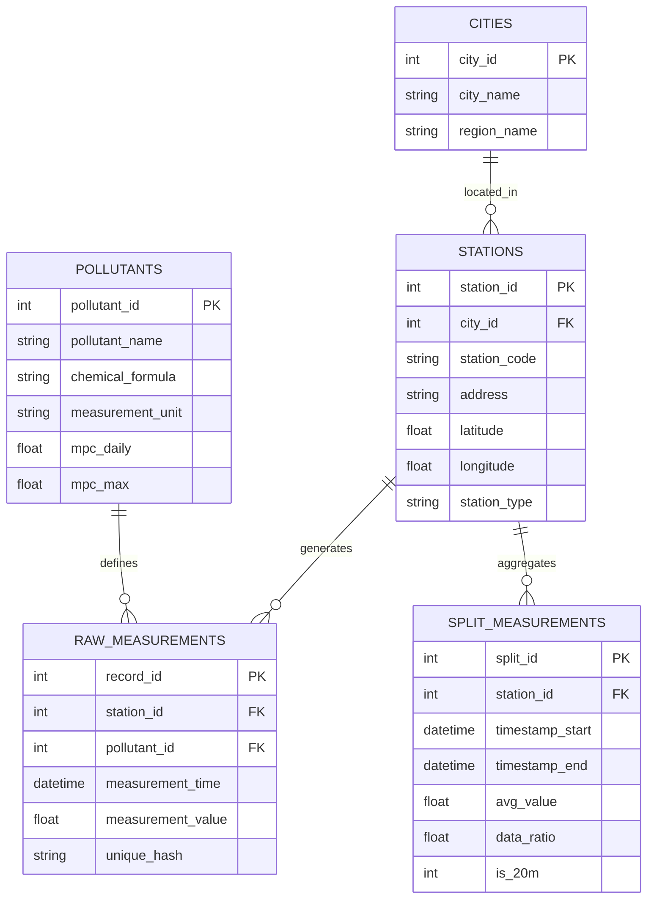

# Лабораторна робота № 3. Розробка реляційної структури екологічної бази даних для збереження показників забруднення атмосферного повітря

**Мета:** сформувати систему практичних умінь щодо концептуального та логічного проєктування реляційних баз даних екологічного призначення; опанувати правила послідовної нормалізації структури даних (перша, друга та третя нормальні форми) для збереження вимірювань якості атмосферного повітря; навчитися організовувати зв'язки між сутностями за допомогою первинних і зовнішніх ключів, формувати унікальні цифрові відбитки рядків (контрольні суми) для запобігання дублюванню інформації, а також розраховувати агреговані 20-хвилинні часові зрізи з оцінкою повноти даних засобами табличного процесора Microsoft Excel або Google Таблиці.

---

## Короткі теоретичні відомості

Автоматизовані комплекси спостереження за станом атмосферного повітря генерують високочастотні потоки первинних вимірювань. Наприклад, автоматична станція муніципального або промислового рівня (зокрема комплекси Vaisala AQT530 або станції мережі EcoCity) фіксує концентрації домішок щохвилини, що утворює понад 1440 інформаційних пакетів на добу лише від одного приладу. Збереження таких масивів у вигляді єдиної монолітної таблиці призводить до надмірної інформаційної надлишковості, виникнення аномалій модифікації, втрати цілісності та критичного уповільнення аналітичної обробки.

Оптимальна організація екологічного сховища базується на реляційній моделі даних, де інформація розподіляється між пов'язаними сутностями відповідно до правил нормалізації. Перша нормальна форма (1NF) вимагає атомарності всіх значень: кожна клітинка повинна містити лише одне неподільне значення, а повторювані групи стовпців мають бути усунені. Друга нормальна форма (2NF) потребує виконання вимог 1NF та відсутності часткової функціональної залежності неключових атрибутів від складеного первинного ключа. Третя нормальна форма (3NF) гарантує відсутність транзитивних залежностей, тобто будь-який неключовий атрибут повинен залежати виключно від первинного ключа сутності.



Архітектура професійних систем екологічного моніторингу передбачає обов'язковий функціональний поділ бази даних на дві взаємопов'язані частини: буферні таблиці оперативної фіксації первинних («сирих») хвилинних показів (наприклад, `station_T3950716`, `station1748`) та таблиці консолідованих агрегованих показників (наприклад, `split_measurement_ua171`). Такий підхід дозволяє зберігати детальні хвилинні вимірювання протягом обмеженого періоду первинної валідації (наприклад, одного місяця), після чого детальні логи очищуються, а для довгострокового зберігання та трендового аналізу залишаються нормалізовані 20-хвилинні, середньодобові та середньорічні значення.

Важливою функцією системи управління базою даних є запобігання повторному внесенню однакових вимірювань під час перезапуску ліній зв'язку або повторних опитувань сенсорів через мережевий шлюз. Захист від колізій забезпечується формуванням унікального цифрового геш-коду для кожного рядка вимірювання. Такий геш розраховується на основі комбінації ключових атрибутів спостереження за алгоритмом:

$$\text{unique\_hash} = \text{MD5}(\text{place\_id} \mathbin{\Vert} \text{measurement\_time} \mathbin{\Vert} \text{option} \mathbin{\Vert} \text{measurement\_value})$$

де символ $\mathbin{\Vert}$ позначає операцію конкатенації (зчеплення) текстових значень, атрибут $\text{place\_id}$ позначає системний ідентифікатор поста, поле $\text{measurement\_time}$ відповідає точній часовій мітці спостереження, змінна $\text{option}$ вказує код вимірюваного параметра, а величина $\text{measurement\_value}$ задає зареєстровану числову концентрацію.

Якість накопиченої екологічної інформації оцінюється двома обов'язковими системними показниками: повнотою вибірки та її достовірністю. Показник повноти даних за встановлений часовий інтервал усереднення (наприклад, 20 хвилин) визначається математичним співвідношенням:

$$\mathcal{K}_{\text{ratio}} = \frac{N_{\text{filled}}}{N_{\text{expected}}}$$

де величина $N_{\text{filled}}$ позначає фактичну кількість валідних вимірювань, зафіксованих датчиком за аналізований інтервал часу, а параметр $N_{\text{expected}}$ визначає нормативну кількість вимірів згідно з регламентом приладу (для хвилинного опитування $N_{\text{expected}} = 20$). Якщо коефіцієнт повноти становить менше 0,75 (тобто зафіксовано менше 75% очікуваних спостережень), відповідний 20-хвилинний інтервал бракується і не враховується під час розрахунку середньодобових величин відповідно до норм європейського стандарту EN 14211.

Показник достовірності інтегрованого масиву спостережень розраховується за формулою:

$$\mathcal{K}_{\text{rel}} = 1 - \frac{N_{\text{err}}}{N_{\text{total}}}$$

де змінна $N_{\text{err}}$ позначає кількість аномальних, збійних або відкинутих точок вимірювання, а параметр $N_{\text{total}}$ визначає загальну кількість записів, завантажених у сховище.

Для структурування параметрів багатокомпонентного середовища у базі даних використовується єдина система ідентифікації та фізичної розмірності, параметри якої наведено у наступній нормативно-довідковій таблиці.

| Назва сутності / поля | Позначення в системі | Тип даних у базі | Одиниця вимірювання | Нормативне призначення |
| :--- | :--- | :--- | :--- | :--- |
| Ідентифікатор запису | `id` | Ціле число (PK) | Відсутня | Унікальний первинний ключ рядка |
| Часова мітка вимірювання | `measurement_time` | Дата і час | `YYYY-MM-DD HH:MM:SS` | Фіксація астрономічного часу спостереження |
| Ідентифікатор станції | `station_id` | Ціле число (FK) | Відсутня | Зв'язок із паспортом вимірювального поста |
| Концентрація пилу PM2.5 | `dust_PM2_5` | Дійсне число | $\text{мг/м}^3$ | Моніторинг дрібнодисперсних аерозолів |
| Концентрація пилу PM10 | `dust_PM10` | Дійсне число | $\text{мг/м}^3$ | Моніторинг грубодисперсних частинок пилу |
| Діоксид азоту | `nitrogen_dioxide` | Дійсне число | $\text{мг/м}^3$ | Контроль викидів енергетики та автотранспорту |
| Оксид вуглецю | `carbon_oxide` | Дійсне число | $\text{мг/м}^3$ | Оцінка повноти згоряння палива у двигунах |
| Діоксид сірки | `sulfur_dioxide` | Дійсне число | $\text{мг/м}^3$ | Індикація спалювання високосірчистого мазуту/вугілля |
| Коефіцієнт повноти | `measurement_ratio` | Дійсне число | Частка від 0 до 1 | Контроль достовірності та валідності даних |
| Хеш-відбиток рядка | `unique_hash` | Рядок (MD5) | Символьний код | Захист від повторного запису дублікатів |

> **ВАЖЛИВО:** Реляційна цілісність екологічної бази даних вимагає налаштування правила обмеження зовнішнього ключа: видалення станції моніторингу або типу хімічної сполуки не повинно призводити до каскадного видалення історичного ряду вимірювань. У реальних системах використовується механізм м'якого видалення (Soft Deletes), за якого у таблиці фіксується дата виведення обладнання з експлуатації (`deleted_at`), але всі історичні логи залишаються доступними для наукового аналізу.

> **ПРАКТИЧНИЙ ЯКІР:** У структурі бази даних екологічної лабораторії міста Кременчук таблиця `split_measurement_ua171` забезпечує уніфіковане зберігання як газових компонентів від сенсорів Vaisala, так і додаткових метеорологічних параметрів (швидкість, пориви та напрямок вітру, вологість, інтенсивність опадів), що уможливлює проведення кореляційного аналізу розсіювання викидів в одному просторі запитів.

> **ТИПОВА ПОМИЛКА:** Збереження числових значень концентрацій разом з одиницями вимірювання в одній текстовій клітинці (наприклад, запис `0.042 мг/м3` замість окремого числового значення `0.042` та винесення розмірності у довідник сутності `pollutants`). Таке порушення першої нормальної форми унеможливлює виконання математичних операцій усереднення, пошуку екстремумів та фільтрації за пороговими значеннями ГДК.

---

## Порядок виконання роботи

Для виконання завдань використовується вхідний файл `air_database_raw_data.xlsx`, наданий викладачем. Усі етапи проєктування структури та розрахункової агрегації виконуються засобами електронних таблиць Microsoft Excel або Google Таблиці.

### Етап 1. Аналіз структури первинного денормалізованого масиву
Здобувач відкриває аркуш вихідних даних у файлі `air_database_raw_data.xlsx` відповідно до номера свого варіанта. Необхідно дослідити структуру представлення первинного масиву, виявити наявні аномалії надлишковості (повторення назви міста, координат, текстових назв приладів у кожному рядку вимірювань) та зафіксувати перелік параметрів, що підлягають нормалізації.

### Етап 2. Розробка нормалізованої схеми бази даних (1NF, 2NF, 3NF)
На окремих нових аркушах табличного процесора здобувач формує три довідкові таблиці, що усувають дублювання неключових атрибутів:
* Аркуш `tbl_cities`: містить стовпці `city_id` (первинний ключ), `city_name`, `region_name`.
* Аркуш `tbl_stations`: містить стовпці `station_id` (первинний ключ), `city_id` (зовнішній ключ), `station_code`, `address`, `latitude`, `longitude`, `station_type`.
* Аркуш `tbl_pollutants`: містить стовпці `pollutant_id` (первинний ключ), `pollutant_name`, `chemical_formula`, `measurement_unit`, `mpc_daily`, `mpc_max`.

### Етап 3. Зв'язування сутностей за допомогою первинних і зовнішніх ключів
У робочій таблиці вимірювань текстові назви станцій та забруднюючих речовин замінюються на їхні числові ідентифікатори (`station_id` та `pollutant_id`). Для автоматичного зіставлення та перевірки зв'язків між таблицями здобувач налаштовує стандартні функції пошуку:
```excel
=XLOOKUP(A2; tbl_stations!B:B; tbl_stations!A:A)
```
або за допомогою класичної функції пошуку:
```excel
=ВПР(A2; tbl_stations!A:E; 1; ХИБНІСТЬ)
```
За результатами налаштування перевіряється відсутність помилок зв'язування `#Н/Д` або `#N/A`.

### Етап 4. Моделювання механізму запобігання дублікатам через унікальний цифровий геш
Для захисту сховища від повторних пакетів вимірювань в окремому стовпці таблиці первинних спостережень моделюється алгоритм генерації унікального цифрового відбитка рядка. За допомогою текстових функцій формується конкатенований базовий рядок:
```excel
=ЗЦЕПИТИ(B2; "_"; ТЕКСТ(C2; "РРРР-ММ-ДД ГГ:ХХ:СС"); "_"; D2; "_"; ТЕКСТ(E2; "0,0000"))
```
Для отримання спрощеного числового контрольного коду в умовах табличного процесора використовується комбінація вбудованих функцій підрахунку довжини та кодових позицій символів, що моделює поведінку геш-функції, або застосовується вбудована функція генерації контрольної суми. За допомогою інструмента «Умовне форматування -> Повторювані значення» здобувач ідентифікує та видаляє потенційні дублікати записів.

### Етап 5. Формування агрегованої таблиці 20-хвилинних часових зрізів
Здобувач створює структуру цільової аналітичної таблиці `tbl_split_measurements`. За допомогою стандартного інструмента «Зведена таблиця» (Pivot Table) або розрахункових функцій умовного підсумовування формуються 20-хвилинні інтервали спостережень, для кожного з яких обчислюються:
* Середнє арифметичне значення концентрації речовини за інтервал:
```excel
=AVERAGEIFS(Діапазон_концентрацій; Діапазон_часу; ">=Початок_інтервалу"; Діапазон_часу; "<Кінець_інтервалу")
```
* Кількість фактично отриманих хвилинних замірів:
```excel
=COUNTIFS(Діапазон_часу; ">=Початок_інтервалу"; Діапазон_часу; "<Кінець_інтервалу")
```
* Розрахунковий коефіцієнт повноти даних $\mathcal{K}_{\text{ratio}}$ (діленням кількості отриманих замірів на 20).

### Етап 6. Верифікація валідності сформованих часових зрізів
Для кожного сформованого 20-хвилинного часового зрізу реалізується логічна перевірка відповідності нормативу повноти даних (не менше 75% валідних вимірювань за квант часу):
```excel
=ЯКЩО(Коефіцієнт_повноти >= 0,75; "VALID"; "REJECTED")
```
Здобувач підраховує частку забракованих інтервалів у масиві та формулює висновок щодо надійності каналу збору телеметричної інформації.

---

## Індивідуальні завдання

Здобувач обирає свій варіант за наведеною нижче таблицею та вибирає з файлу `air_database_raw_data.xlsx` відповідний набір даних моніторингових станцій для виконання нормалізації та побудови реляційної моделі.

| Варіант | Досліджуваний об'єкт / станція | Тип вимірювального комплексу | Первинна дискретизація | Перелік контрольованих параметрів | Цільовий квант агрегації |
| :---: | :--- | :--- | :---: | :--- | :---: |
| 1 | Станція Vaisala T3950716 (Північний вузол) | Промисловий стаціонарний | 1 хвилина | $\text{PM}_{10}, \text{PM}_{2.5}, \text{SO}_2, \text{NO}_2$ | 20 хвилин |
| 2 | Станція Vaisala T3950713 (Район «Фаворит») | Муніципальний автоматичний | 1 хвилина | $\text{CO}, \text{NO}_2, \text{PM}_{2.5}, \text{Температура}$ | 20 хвилин |
| 3 | Станція Vaisala V0440346 (Гімназія № 26) | Автоматичний житлової зони | 1 хвилина | $\text{CO}, \text{H}_2\text{S}, \text{Вологість}, \text{Тиск}$ | 20 хвилин |
| 4 | Станція EcoCity 1756 (Крюківський міст) | Транспортний моніторинговий | 1 хвилина | $\text{NO}_2, \text{CO}, \text{PM}_{2.5}, \text{Сажа}$ | 20 хвилин |
| 5 | Станція EcoCity 1748 (вул. Соборна) | Муніципальний індикативний | 1 хвилина | $\text{PM}_{10}, \text{PM}_{2.5}, \text{HCHO}, \text{NH}_3$ | 20 хвилин |
| 6 | Станція EcoCity 1753 (Молодіжний масив) | Муніципальний індикативний | 1 хвилина | $\text{CO}_2, \text{PM}_{2.5}, \text{O}_3, \text{Температура}$ | 20 хвилин |
| 7 | Диспетчерський комплекс КП «НДЦ» | Муніципальний централізований | 1 хвилина | $\text{Dust}, \text{SO}_2, \text{NO}_2, \text{CO}$ | 60 хвилин (година) |
| 8 | Лабораторія ПМЕЛ-1 (Проммайданчик) | Стаціонарний газоаналізаторний | 5 хвилин | $\text{SO}_2, \text{H}_2\text{S}, \text{Фенол}, \text{Швидкість вітру}$ | 60 хвилин (година) |
| 9 | Сенсорна мережа навчального корпусу | Лабораторний дослідницький | 1 хвилина | $\text{CO}_2, \text{VOC}, \text{Температура}, \text{Вологість}$ | 20 хвилин |
| 10 | Регіональний пост (Горішні Плавні) | Регіональний стаціонарний | 5 хвилин | $\text{Dust}, \text{SO}_2, \text{NO}_2, \text{PM}_{10}$ | 60 хвилин (година) |

---

## Вимоги до змісту звіту

Звіт оформлюється в електронному вигляді у форматі PDF або DOCX та подається на перевірку разом із файлом сконструйованої бази даних у форматі XLSX або Google Таблиць.

Структура звіту повинна містити такі обов'язкові розділи:
1. **Титульна сторінка:** містить найменування навчального закладу, інституту, випускової кафедри, назву навчальної дисципліни, тему лабораторної роботи, номер варіанта індивідуального завдання, а також прізвище, ініціали та навчальну групу здобувача.
2. **Мета роботи:** чітке формулювання дослідницьких і розрахункових цілей відповідно до наданих методичних вказівок.
3. **Порядок виконання роботи:** опис етапів перетворення первинного масиву спостережень, обґрунтування виділення окремих таблиць-довідників відповідно до вимог 1NF, 2NF та 3NF, опис використаних розрахункових функцій Excel.
4. **Результати проєктування та розрахунків:**
   * Графічна або таблична схема розробленої реляційної моделі бази даних із зазначенням зв'язків між первинними (PK) та зовнішніми (FK) ключами.
   * Скриншоти спроєктованих довідкових таблиць (`tbl_cities`, `tbl_stations`, `tbl_pollutants`) із заповненими даними згідно з варіантом.
   * Таблиця згенерованих цифрових геш-відбитків рядків та протокол виявлення й видалення дублікатів вимірювань.
   * Розрахункова таблиця сформованих 20-хвилинних агрегованих зрізів (`tbl_split_measurements`) із числовими значеннями середніх концентрацій та коефіцієнтів повноти $\mathcal{K}_{\text{ratio}}$.
   * Гістограма розподілу повноти даних за досліджуваний часовий інтервал із виділенням невалідних періодів спостереження.
5. **Аналітичні висновки:** фахова оцінка надійності структури розробленої екологічної бази даних; аналіз причин неповноти інформаційних рядів (вплив збоїв зв'язку чи відключення електроживлення на сенсорах); рекомендації щодо тривалості зберігання сирих хвилинних логів перед архівацією.
6. **Відповіді на контрольні запитання:** розгорнуті письмові відповіді на всі контрольні запитання, наведені у розділі 5.

---

## 5 Контрольні запитання

1. У чому полягає системна небезпека збереження ненормалізованих екологічних часових рядів в одній монолітній таблиці, і які типи інформаційних аномалій виникають під час ручного редагування такої структури?
2. Опишіть сутність та практичні вимоги першої, другої та третьої нормальних форм (1NF, 2NF, 3NF) стосовно специфіки збереження геопросторових і хімічних показників стану навколишнього середовища.
3. Чому архітектура муніципальних систем екологічного моніторингу вимагає функціонального розділення сховища на таблиці для зберігання «сирих» хвилинних даних та таблиці консолідованих часових зрізів (`split_measurements`)?
4. Яким чином використання алгоритмів цифрового гешування (зокрема MD5) дозволяє запобігати дублюванню телеметричних пакетів під час нестійкого зв'язку з польовими станціями моніторингу?
5. Який нормативний критерій повноти екологічних спостережень ($\mathcal{K}_{\text{ratio}}$) встановлено європейськими стандартами для визнання розрахованих агрегованих показників валідними, і як відсікання нерепрезентативних даних впливає на подальшу оцінку відповідності якості повітря нормативам ГДК?