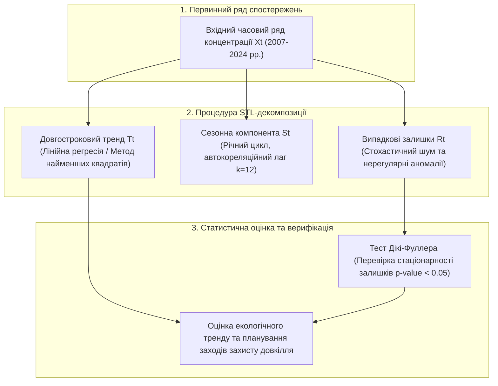

# Лабораторна робота № 4. Статистична обробка часових рядів концентрацій екологічних забруднювачів

**Мета:** сформувати систему практичних умінь щодо статистичного аналізу тривалих часових рядів екологічних спостережень; опанувати методи первинної фільтрації аномальних викидів за міжквартильним розмахом і правилом Тьюкі в табличному процесорі Microsoft Excel або Google Таблиці; навчитися виділяти довгострокові тренди, сезонні коливання та випадкові стохастичні залишки за допомогою адитивної STL-декомпозиції, а також оцінювати стаціонарність екологічних рядів за критерієм Дікі-Фуллера за допомогою інтерактивного блокнота Google Colab без необхідності самостійного написання програмного коду.

---

## Короткі теоретичні відомості

Екологічні часові ряди, що формуються мережами автоматичного та лабораторного моніторингу якості повітря, характеризуються вираженою стохастичністю, багатомасштабною періодичністю та наявністю структурних порушень. Багаторічні спостереження фіксують складний динамічний відгук природного середовища на антропогенну діяльність промислових підприємств, викиди автотранспорту, а також на циклічні зміни метеорологічних чинників (температурні інверсії, сезонні зміни напрямку вітру, коливання сонячної радіації та атмосферної вологості).

Для коректного екологічного прогнозування та виявлення стійких тенденцій деградації чи відновлення урбоекосистем вихідний часовий ряд розкладають на окремі некорельовані функціональні компоненти. Найпоширенішим підходом є адитивна модель декомпозиції часового ряду:

$$X_t = T_t + S_t + R_t$$

де змінна $X_t$ позначає фактичне виміряне значення концентрації забруднюючої речовини у дискретний момент часу $t$; функція $T_t$ описує детермінований довгостроковий (секулярний) тренд динаміки забруднення; складова $S_t$ являє собою строго періодичну сезонну компоненту з базовим річним лагом $s = 12$ місяців; змінна $R_t$ відповідає залишковому стохастичному шуму (резидуалам), що виникає внаслідок непередбачуваних природних аномалій, аварійних емісій або апаратних похибок вимірювальних трактів.



Для попереднього виявлення та відсікання грубих помилок вимірювань використовується непараметричний метод Тьюкі, заснований на процентильному розподілі вибірки. Даний метод є стійким до значних аномальних викидів і не вимагає нормального закону розподілу даних:

$$\text{IQR} = Q_3 - Q_1$$

$$\text{Lower Fence} = Q_1 - 1,5 \cdot \text{IQR}, \quad \text{Upper Fence} = Q_3 + 1,5 \cdot \text{IQR}$$

де параметр $\text{IQR}$ визначає міжквартильний розмах вибірки; величини $Q_1$ та $Q_3$ відповідають 25-му (нижньому) та 75-му (верхньому) квартилям емпіричного розподілу концентрацій; інтервал $[\text{Lower Fence}; \, \text{Upper Fence}]$ задає межі нормальної статистичної варіативності показника, за межами якого заміри класифікуються як аномальні та підлягають додатковій перевірці.

Довгостроковий детермінований тренд $T_t$ апроксимується лінійним рівнянням парної регресії:

$$T_t = at + b$$

Параметри лінії тренду обчислюються класичним методом найменших квадратів за формулами:

$$a = \frac{\sum_{t=1}^{T} (t - \bar{t})(X_t - \mu)}{\sum_{t=1}^{T} (t - \bar{t})^2}, \quad b = \mu - a \bar{t}$$

де коефіцієнт $a$ відображає швидкість міжрічної зміни концентрації речовини (додатне значення вказує на прогресуюче погіршення стану довкілля, від'ємне — на поступове зниження рівня забруднення); параметр $\mu$ задає середнє арифметичне значення ряду; величина $\bar{t}$ позначає середнє значення часових міток.

Наявність періодичної сезонної хвилі перевіряється за допомогою розрахунку автокореляційної функції (ACF) для різних часових зміщень (лагів) $k$:

$$\text{ACF}(k) = \frac{\sum_{t=1}^{T-k} (X_t - \mu)(X_{t+k} - \mu)}{\sum_{t=1}^{T} (X_t - \mu)^2}$$

Часовий ряд класифікується як сезонний, якщо значення функції $\text{ACF}(k)$ для лагу $k = 12$ (у помісячних рядах) перевищує статистичний поріг 0,1. Це відображає наявність стабільного річного кліматичного циклу у процесах переносу та трансформації забруднюючих речовин.

Стаціонарність часового ряду перевіряється розширеним тестом Дікі-Фуллера (Augmented Dickey-Fuller test, ADF). Стаціонарність означає незмінність середнього значення, дисперсії та автоковаріаційної структури ряду в часі. Критерій прийняття рішення формулюється через досягнутий рівень значущості: якщо розрахована величина $p\text{-value} < 0,05$, нульова гіпотеза про наявність одиничного кореня відхиляється, а досліджуваний ряд визнається стаціонарним. Більшість первинних екологічних рядів забруднювачів є нестаціонарними ($p\text{-value} \ge 0,05$), тоді як залишкова компонента $R_t$ після якісного вилучення тренду та сезонності повинна бути строго стаціонарною.

Основні статистичні та нормативні критерії, що використовуються для класифікації динаміки часових рядів якості повітря, зведено у наступній таблиці.

| Статистичний індикатор | Математичний критерій | Екологічний зміст індикатора | Діагностичний висновок для моніторингу |
| :--- | :--- | :--- | :--- |
| Напрямок лінійного тренду | $a > 0$ або $a < 0$ | Швидкість зміни техногенного навантаження | Свідчить про деградацію або покращення стану урбоекосистеми |
| Коефіцієнт детермінації | $R^2 \ge 0,50$ | Частка дисперсії, пояснена трендом | Стійкий систематичний вплив факторів на якість повітря |
| Автокореляція першого лагу | $\text{ACF}(1) > 0,70$ | Часова інерційність екологічної системи | Висока залежність поточної концентрації від попереднього стану |
| Річна сезонність | $\text{ACF}(12) > 0,10$ | Вплив кліматичного річного циклу | Сезонна мінливість опалювального сезону чи літніх температур |
| Рівень значущості ADF-тесту | $p\text{-value} < 0,05$ | Стаціонарність процесу в часі | Ряд є статистично рівноважним, відсутній стохастичний дрейф |
| Рівень значущості ADF-тесту | $p\text{-value} \ge 0,05$ | Нестаціонарність процесу в часі | Наявні глибинні системні зрушення, потрібна стабілізація екосистеми |

> **ВАЖЛИВО:** Виконання розрахунків залишків $R_t = X_t - T_t - S_t$ є ключовим етапом валідації математичних моделей моніторингу довкілля. Якщо після декомпозиції залишки залишаються нестаціонарними або демонструють значну автокореляцію, це вказує на те, що модель не врахувала важливий систематичний антропогенний чинник (наприклад, введення в експлуатацію нової промислової установки або зміну структури міського трафіку).

> **ПРАКТИЧНИЙ ЯКІР:** Аналіз 17-річного ретроспективного ряду пилу на стаціонарному пості № 4 у місті Кременчук (2007–2024 роки) зафіксував зниження трендової лінії з 1,2 ГДК до показників нижче 1,0 ГДК після 2019 року, що пояснюється введенням жорсткіших екологічних регламентів на промислових підприємствах міста та поступовою модернізацією технологічного пилогазоочисного обладнання.

> **ТИПОВА ПОМИЛКА:** Намагання оцінювати сезонність за короткочасними вибірками тривалістю менше двох повних календарних циклів (менше 24 місяців). При аналізі коротких рядів випадкові сезонні аномалії погоди (наприклад, аномально тепла зима або сухе літо) помилково сприймаються за стійкий міжрічний тренд, що призводить до хибних управлінських висновків.

---

## Порядок виконання роботи

Для виконання лабораторної роботи використовується масив ретроспективних щомісячних вимірювань `air_timeseries_2007_2024.xlsx`, наданий викладачем. Робота складається з двох послідовних етапів: первинна статистична обробка та лінійний регресійний аналіз виконуються в середовищі MS Excel або Google Таблиці, а STL-декомпозиція та тест ADF — у попередньо сконфігурованому блокноті Google Colab.

### Етап 1. Імпорт вибірки та розрахунок базових описових статистик
Здобувач відкриває аркуш файлу `air_timeseries_2007_2024.xlsx` відповідно до номера свого варіанта. У табличному процесорі для досліджуваного 17-річного ряду щомісячних спостережень (204 точки) обчислюються основні статистичні характеристики: середнє арифметичне значення (функція `=AVERAGE`), вибіркова дисперсія (функція `=VAR.S`), стандартне відхилення (функція `=STDEV.S`), медіана (функція `=MEDIAN`), а також перший і третій квартилі (функції `=QUARTILE.INC(..., 1)` та `=QUARTILE.INC(..., 3)` відповідно).

### Етап 2. Ідентифікація аномальних точок за правилом Тьюкі
В окремому розрахунковому блоці таблиці обчислюється міжквартильний розмах як різниця між третім та першим квартилями. Розраховуються верхній та нижній бар'єри Тьюкі. За допомогою логічної функції створюється індикатор виявлення аномальних спостережень:
```excel
=ЯКЩО(АБО(B2 > Верхній_бар'єр; B2 < Нижній_бар'єр); "OUTLIER"; "NORMAL")
```
Здобувач підраховує кількість виявлених викидів та зазначає календарні роки і місяці, на які припадають екстремальні рівні забруднення.

### Етап 3. Розрахунок параметрів лінійного тренду та коефіцієнта детермінації
На основі стовпця часових періодів (порядкові номери місяців від 1 до 204) та виміряних концентрацій забруднювача за допомогою статистичних функцій табличного процесора обчислюються коефіцієнти лінійного тренду:
* Коефіцієнт нахилу лінії тренду:
```excel
=SLOPE(Діапазон_концентрацій; Діапазон_часу)
```
* Вільний член рівняння регресії:
```excel
=INTERCEPT(Діапазон_концентрацій; Діапазон_часу)
```
* Коефіцієнт детермінації моделі:
```excel
=RSQ(Діапазон_концентрацій; Діапазон_часу)
```
Будується графік вихідного часового ряду з накладеною пунктирною лінією лінійного тренду та відображенням розрахованого рівняння регресії.

### Етап 4. Оцінка автокореляції та виявлення річної сезонності
Для дослідження внутрішньовічної циклічності в таблиці формується стовпець зміщення значень на 12 місяців (лаг 12). За допомогою вбудованої функції кореляції обчислюється коефіцієнт автокореляції першого лагу (між сусідніми місяцями) та дванадцятого лагу (між однаковими місяцями різних років):
```excel
=CORREL(Діапазон_X_t; Діапазон_X_t_plus_12)
```
Отримане значення зіставляється з порогом 0,1 для формування висновку про наявність вираженої річної сезонної циклічності.

### Етап 5. Автоматизована декомпозиція ряду та ADF-тест у Google Colab
Здобувач переходить за наданим викладачем посиланням до хмарного блокнота Google Colab. У графічній формі інтерфейсу (без редагування коду) завантажується файл із даними свого варіанта, обирається назва хімічної речовини та задається період сезонності, що дорівнює 12 місяцям. Натисканням кнопки виконання генерується чотирипанельний графік STL-декомпозиції: вихідний ряд, згладжений тренд, сезонна гармоніка та ряд резидуалів. З вихідної панелі блокнота фіксується розраховане значення тестової статистики Дікі-Фуллера та його $p\text{-value}$.

### Етап 6. Комплексна інтерпретація результатів декомпозиції
Здобувач аналізує графік виділеної сезонної компоненти, визначаючи календарні місяці, в яких регулярно спостерігаються пікові максимуми та мінімуми забруднення. Співвідносячи отримане значення $p\text{-value}$ тесту ADF для залишків із рівнем 0,05, здобувач робить висновок про адекватність усунення нелінійних трендів та формулює аналітичну оцінку довгострокового екологічного стану території спостереження.

---

## Індивідуальні завдання

Здобувач обирає номер індивідуального варіанта за наведеною таблицею, знаходить у файлі `air_timeseries_2007_2024.xlsx` відповідний набір помісячних спостережень і проводить повний статистичний цикл аналізу вказаного забруднювача за наведений часовий проміжок.

| Варіант | Пункт спостереження | Досліджуваний забруднювач | Аналізований період | Кількість точок | Цільовий норматив ГДК, $\text{мг/м}^3$ |
| :---: | :--- | :--- | :---: | :---: | :---: |
| 1 | Пост № 4 (вул. Шевченка, 22/30) | Пил недиференційований ($\text{Dust}$) | 2007–2024 рр. | 204 | 0,150 (середньодобова) |
| 2 | Пост № 1 (вул. Молодіжна, 9) | Формальдегід ($\text{HCHO}$) | 2007–2024 рр. | 204 | 0,003 (середньодобова) |
| 3 | Пост № 2 (вул. Лікаря Богаєвського) | Діоксид азоту ($\text{NO}_2$) | 2008–2024 рр. | 192 | 0,040 (середньодобова) |
| 4 | Пост № 5 (вул. І. Приходька, 89) | Оксид вуглецю ($\text{CO}$) | 2007–2024 рр. | 204 | 3,000 (середньодобова) |
| 5 | Пост № 4 (вул. Шевченка, 22/30) | Діоксид сірки ($\text{SO}_2$) | 2009–2024 рр. | 180 | 0,050 (середньодобова) |
| 6 | Станція Vaisala T3950716 (Північний вузол) | Діоксид азоту ($\text{NO}_2$) | 2021–2024 рр. | 35 | 0,040 (середньодобова) |
| 7 | Станція Vaisala T3950713 (Район «Фаворит») | Оксид вуглецю ($\text{CO}$) | 2021–2024 рр. | 35 | 3,000 (середньодобова) |
| 8 | Станція Vaisala V0440346 (Гімназія № 26) | Атмосферний тиск (метео) | 2021–2024 рр. | 35 | Норма 101,3 кПа |
| 9 | Пост № 1, м. Горішні Плавні | Пил недиференційований ($\text{Dust}$) | 2012–2024 рр. | 144 | 0,150 (середньодобова) |
| 10 | Пост № 1 (вул. Молодіжна, 9) | Сажа ($\text{C}$) | 2007–2024 рр. | 204 | 0,050 (середньодобова) |

---

## Вимоги до змісту звіту

Звіт оформлюється в електронному вигляді у форматі PDF або DOCX та подається на перевірку разом із розрахунковою таблицею у форматі XLSX.

Структура звіту повинна містити такі обов'язкові розділи:
1. **Титульна сторінка:** містить найменування навчального закладу, інституту, випускової кафедри, назву навчальної дисципліни, тему лабораторної роботи, номер варіанта індивідуального завдання, а також прізвище, ініціали та навчальну групу здобувача.
2. **Мета роботи:** чітке формулювання дослідницьких і розрахункових цілей відповідно до наданих методичних вказівок.
3. **Порядок виконання роботи:** структурований опис послідовності обчислювальних дій в електронних таблицях та середовищі Google Colab із наведенням розрахункових формул.
4. **Результати розрахунків та візуалізація:**
   * Зведена таблиця базових описових статистик (середнє, дисперсія, стандартне відхилення, квартилі, міжквартильний розмах).
   * Протокол скринінгу аномальних точок за правилом Тьюкі із зазначенням меж допуску та переліку виявлених викидів.
   * Графік вихідного часового ряду спостережень із лінією довгострокового регресійного тренду, рівнянням та величиною $R^2$.
   * Чотирипанельний графік STL-декомпозиції (вихідний ряд, тренд, річна сезонна гармоніка, залишковий шум), згенерований у середовищі Google Colab.
   * Числові результати тесту ADF (тестова статистика, критичні значення, розраховане $p\text{-value}$) для вихідного ряду та ряду залишків.
5. **Аналітичні висновки:** фахова екологічна інтерпретація довгострокових змін якості повітря на досліджуваній території; характеристика сезонних амплітуд забруднення (вказівка місяців максимального ризику та їх прив'язка до опалювального періоду чи літньої інсоляції); аналіз стаціонарності та пояснення походження випадкових залишків.
6. **Відповіді на контрольні запитання:** розгорнуті письмові відповіді на всі контрольні запитання, наведені у розділі 5.

---

## 5 Контрольні запитання

1. Які принципові відмінності існують між адитивною та мультиплікативною моделями структури екологічного часового ряду, і за яких умов поведінки сезонних амплітуд застосовується адитивна схема $X_t = T_t + S_t + R_t$?
2. У чому полягає математична перевага використання міжквартильного розмаху ($\text{IQR}$) та бар'єрів Тьюкі для виявлення аномальних вимірювань у порівнянні з класичним правилом трьох сигм ($3\sigma$)?
3. Який фізичний та екологічний зміст має коефіцієнт нахилу $a$ у лінійній моделі апроксимації тренду концентрації забруднюючої речовини за 17-річний період спостережень?
4. Які метеорологічні та техногенні чинники зумовлюють наявність стійкої річної циклічності (лаг 12 місяців) у часових рядах концентрацій пилу, оксидів азоту та формальдегіду в урбанізованих промислових районах?
5. Чому наявність нестаціонарності у первинному ряді спостережень ускладнює пряме статистичне прогнозування, та яку властивість повинні мати резидуали ($R_t$) після коректного вилучення тренду й сезонності з погляду тесту Дікі-Фуллера?