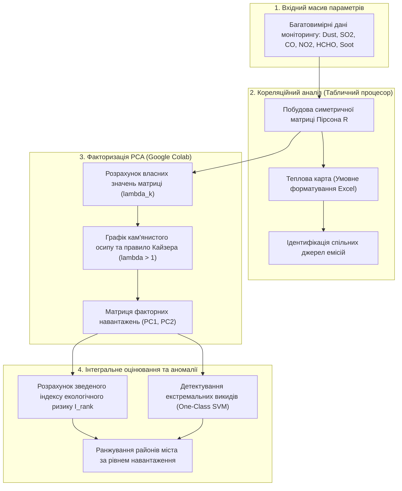

# Лабораторна робота № 5. Класифікація та ранжування муніципальних об’єктів за рівнем екологічного навантаження методом головних компонент

**Мета:** сформувати систему практичних умінь щодо аналізу багатовимірних взаємозв'язків між хімічними забруднювачами та зниження розмірності простору екологічних ознак; опанувати методи розрахунку й візуалізації кореляційних матриць Пірсона засобами табличного процесора Microsoft Excel або Google Таблиці; навчитися виділяти приховані техногенні фактори якості атмосферного повітря за допомогою методу головних компонент (PCA), ранжувати пункти спостереження за інтегральним рівнем антропогенного навантаження та виявляти комплексні хімічні аномалії за допомогою інтерактивного блокнота Google Colab без потреби самостійного програмування.

---

## Короткі теоретичні відомості

У процесі муніципального моніторингу довкілля на кожному вимірювальному пості одночасно фіксується широкий спектр різнорідних забруднюючих речовин. Багатовимірна природа екологічних даних створює явище високої кореляційної залежності (мультиколінеарності) між окремими показниками. Наприклад, концентрації оксиду вуглецю, діоксиду азоту та сажі в урбанізованому середовищі тісно пов'язані між собою через спільне джерело походження — процеси високотемпературного спалювання викопного палива у двигунах автотранспорту та на теплоенергетичних підприємствах. Прямий аналіз десятків окремих речовин для багатьох районів міста ускладнює загальну оцінку екологічного стану території та прийняття своєчасних управлінських рішень.

Для виявлення структури взаємних зв'язків між полютантами обчислюється кореляційна матриця $R$, елементи якої $r_{ij}$ являють собою коефіцієнти лінійної кореляції Пірсона між часовими рядами концентрацій $i$-ї та $j$-ї речовин:

$$r_{ij} = \frac{\text{Cov}(X_i, X_j)}{\sigma_{X_i} \sigma_{X_j}} = \frac{\sum_{t=1}^{T} (x_{i,t} - \mu_i)(x_{j,t} - \mu_j)}{\sqrt{\sum_{t=1}^{T} (x_{i,t} - \mu_i)^2 \sum_{t=1}^{T} (x_{j,t} - \mu_j)^2}}$$

де змінні $x_{i,t}$ та $x_{j,t}$ позначають концентрації відповідних речовин у момент часу $t$; параметри $\mu_i, \mu_j$ є їхніми середніми арифметичними значеннями за досліджуваний період; величини $\sigma_{X_i}, \sigma_{X_j}$ позначають вибіркові середньоквадратичні відхилення відповідних часових рядів.



Метод головних компонент (Principal Component Analysis, PCA) забезпечує перетворення множини $M$ вихідних взаємопов'язаних екологічних змінних у значно меншу кількість $K \ll M$ некорельованих інтегральних факторів (головних компонент), які зберігають переважну частку інформаційної дисперсії вихідного масиву. З геометричного погляду метод виконує ортогональне обертання системи координат уздовж напрямків максимального розкиду вимірювань. Розрахунок дисперсії кожної компоненти зводиться до пошуку власних значень $\lambda_k$ кореляційної матриці:

$$\det(R - \lambda I) = 0$$

Частка дисперсії, що пояснюється $k$-ю головною компонентою, обчислюється як відношення її власного значення до загальної суми власних значень:

$$\eta_k = \frac{\lambda_k}{\sum_{m=1}^{M} \lambda_m} \cdot 100\%$$

Відбір кількості головних компонент, які є достатніми для подальшого аналізу, здійснюється за правилом Кайзера (залишаються компоненти, власні значення яких перевищують одиницю, $\lambda_k > 1$) та за графіком кам'янистого осипу Кеттелла (точка зламу кривої власних значень). Сумарна накопичена дисперсія відібраних компонент зазвичай повинна складати не менше 70–80% загальної дисперсії вибірки.

Для інтегрального порівняння та ранжування різних районів або спостережних пунктів міста за сумарним рівнем екологічної небезпеки розраховується зведений індекс техногенного навантаження ($I_{\text{rank}}$) для кожного вимірювального поста:

$$I_{\text{rank}, i} = \sum_{k=1}^{K} w_k \cdot \text{PC}_{k, i}$$

де параметр $\text{PC}_{k, i}$ позначає стандартизовану оцінку $k$-ї головної компоненти для $i$-го поста; коефіцієнт $w_k = \frac{\lambda_k}{\sum_{j=1}^K \lambda_j}$ задає ваговий внесок відповідної компоненти в сумарну дисперсію системи.

Для ідентифікації екстремальних багатокомпонентних екологічних викидів застосовується алгоритм машинного навчання One-Class Support Vector Machine (One-Class SVM). Алгоритм знаходить розділяючу гіперплощину, яка відокремлює стандартний профіль забруднення від аномальних точок, що виникають під час залпових аварійних скидів або несприятливих метеорологічних умов.

Типові діапазони взаємних кореляційних зв'язків між атмосферними полютантами промислових міст наведено у наступній аналітичній таблиці.

| Пара забруднюючих речовин | Коефіцієнт кореляції ($r$) | Характер зв'язку | Провідний екологічний механізм формування |
| :--- | :--- | :--- | :--- |
| $\text{CO} \longleftrightarrow \text{NO}_2$ | $+0,38 \ldots +0,52$ | Помірний / сильний додатний | Спільні джерела викидів: автомобільний транспорт та пальникові пристрої |
| $\text{CO} \longleftrightarrow \text{HCHO}$ | $+0,40 \ldots +0,50$ | Помірний додатний | Продукти неповного згоряння палива та вторинні фотохімічні реакції |
| $\text{HCHO} \longleftrightarrow \text{Фенол}$ | $+0,35 \ldots +0,48$ | Помірний додатний | Специфічні викиди хімічних, деревообробних та нафтопереробних виробництв |
| $\text{Пил (Dust)} \longleftrightarrow \text{Сажа (Soot)}$ | $+0,30 \ldots +0,45$ | Помірний додатний | Дрібнодисперсні аерозолі механічного стирання шин та димових газів |
| $\text{SO}_2 \longleftrightarrow \text{CO}$ | $-0,10 \ldots -0,20$ | Слабкий від'ємний | Розподіл джерел: $\text{SO}_2$ формується важким промисловим паливом, $\text{CO}$ — легким транспортом |
| $\text{SO}_2 \longleftrightarrow \text{NO}_2$ | $-0,12 \ldots -0,18$ | Слабкий від'ємний | Просторова роз'єднаність факелів високих промислових труб і приземного трафіку |

> **ВАЖЛИВО:** Високий позитивний кореляційний зв'язок між двома забруднювачами свідчить про спільне джерело їх генерації або паралельні атмосферні процеси переносу, тоді як нульова чи слабка від'ємна кореляція вказує на суттєву просторову або технологічну відокремленість джерел викидів.

> **ПРАКТИЧНИЙ ЯКІР:** У промисловому районі Кременчука (район розташування нафтопереробного заводу та Північного промвузла) спостерігається стійка кореляція між оксидом вуглецю та діоксидом азоту ($r = 0,42$), а також між формальдегідом і фенолом ($r = 0,41$), що дозволило за допомогою методу PCA об'єднати шість контрольованих маркерів у два головні фактори: фактор спалювання палива (транспортно-енергетичний) та фактор промислового органічного синтезу.

> **ТИПОВА ПОМИЛКА:** Застосування методу головних компонент без попередньої стандартизації (нормування) вхідних рядів спостережень. Оскільки концентрації оксиду вуглецю вимірюються в одиницях порядку $1,0 \ldots 5,0\text{ мг/м}^3$, а концентрації діоксиду азоту та фенолу становлять $0,001 \ldots 0,04\text{ мг/м}^3$, розрахунок PCA на нестандартизованих даних призводить до того, що перша головна компонента описує виключно оксид вуглецю через його велику абсолютну дисперсію, повністю нівелюючи вплив високотоксичних домішок.

---

## Порядок виконання роботи

Для виконання завдань використовується файл `air_multipollutant_kremenchuk.xlsx`, наданий викладачем. Розрахунок кореляційної матриці та ранжування виконуються в електронних таблицях Excel або Google Таблицях, а факторизація PCA та детектування аномалій — у хмарному блокноті Google Colab.

### Етап 1. Підготовка вихідного масиву багатокомпонентних даних
Здобувач відкриває аркуш файлу `air_multipollutant_kremenchuk.xlsx` відповідно до номера свого варіанта. Необхідно проконтролювати наявність вимірювань за 6–8 забруднюючими речовинами (пил, діоксид сірки, оксид вуглецю, діоксид азоту, формальдегід, фенол, сажа тощо) для кількох спостережних постів. Проводиться очищення масиву від рядків із неповними замірами, забезпечуючи однакову часову довжину рядів для всіх досліджуваних домішок.

### Етап 2. Побудова та візуалізація кореляційної матриці в табличному процесорі
У середовищі MS Excel або Google Таблиці за допомогою надбудови «Аналіз даних -> Кореляція» або стандартної розрахункової формули будується симетрична кореляційна матриця розмірності $M \times M$:
```excel
=CORREL(Діапазон_речовини_A; Діапазон_речовини_B)
```
Для отриманої таблиці налаштовується умовне форматування у вигляді триколірної колірної шкали (синій колір відповідає значенню $-1$, білий — $0$, червоний — $+1$). Здобувач виділяє пари речовин із найбільшим додатним ($r \ge 0,35$) та найбільшим від'ємним зв'язком, заносячи їх до протоколу.

### Етап 3. Виконання аналізу PCA у хмарному блокноті Google Colab
Здобувач переходить до спеціалізованого блокнота Google Colab. У зручній графічній формі інтерфейсу завантажується файл свого варіанта та вмикається обов'язкова опція стандартизації ознак (StandardScaler). Програма виконує сингулярний розклад матриці та виводить на екран:
* Таблицю власних значень $\lambda_k$ для кожної головної компоненти.
* Відсоток дисперсії, що пояснюється кожною окремою компонентою $\eta_k$, та кумулятивну дисперсію.
* Графік кам'янистого осипу власних значень (Scree Plot).

### Етап 4. Визначення кількості значущих компонент та аналіз навантажень
Спираючись на правило Кайзера ($\lambda_k > 1$) та форму графіка осипу, здобувач обирає кількість значущих головних компонент (зазвичай 2 або 3). На екрані блокнота аналізується таблиця факторних навантажень (Factor Loadings), що показує ступінь кореляції кожного первинного забруднювача з виділеними компонентами. Здобувач визначає змістовний екологічний сенс кожної компоненти (наприклад: Головна компонента 1 відповідає транспортному навантаженню, Головна компонента 2 — викидам стаціонарних промислових печей).

### Етап 5. Розрахунок інтегрального індексу навантаження та ранжування постів
Отримані стандартизовані значення перших двох головних компонент копіюються в електронну таблицю Excel. Для кожного пункту спостереження за наведеною у теоретичних відомостях формулою обчислюється зведений індекс екологічного навантаження $I_{\text{rank}}$:
```excel
=(lambda_1 / (lambda_1 + lambda_2)) * PC1 + (lambda_2 / (lambda_1 + lambda_2)) * PC2
```
За отриманими числовими значеннями $I_{\text{rank}}$ проводиться ранжування постів спостереження від найбільш забрудненого (ранг 1) до найбільш екологічно безпечного (фонового).

### Етап 6. Ідентифікація багатовимірних хімічних аномалій через One-Class SVM
У середовищі Google Colab здобувач за допомогою повзунка налаштовує параметр допустимої частки аномалій $\nu$ (від 0,02 до 0,05) та запускає алгоритм One-Class SVM. Програма будує двовимірну діаграму розсіювання вимірювань у площині компонент $\text{PC}_1 - \text{PC}_2$ та позначає червоними маркерами аномальні часові точки, що виходять за межі нормального функціонування урбоекосистеми. Здобувач фіксує дати виявлених інцидентів та співвідносить їх із відомими технологічними подіями.

---

## Індивідуальні завдання

Здобувач обирає індивідуальний варіант за наведеною таблицею, знаходить відповідний набір спостережень у файлі `air_multipollutant_kremenchuk.xlsx` та виконує повний аналітичний цикл факторизації та ранжування.

| Варіант | Досліджувані об'єкти / пости | Перелік контрольованих забруднювачів | Аналізований період | Цільовий параметр аномалій $\nu$ |
| :---: | :--- | :--- | :---: | :---: |
| 1 | Пост № 1 (вул. Молодіжна) та Пост № 4 (вул. Шевченка) | $\text{Dust}, \text{SO}_2, \text{CO}, \text{NO}_2, \text{HCHO}, \text{Фенол}, \text{Сажа}$ | 2019–2024 рр. | 0,03 |
| 2 | Пост № 2 (вул. Богаєвського) та Пост № 5 (вул. Приходька) | $\text{Dust}, \text{SO}_2, \text{CO}, \text{NO}_2, \text{HCHO}, \text{Фенол}$ | 2019–2024 рр. | 0,05 |
| 3 | Станція Vaisala T3950716 (Північний промвузол) | $\text{PM}_{10}, \text{PM}_{2.5}, \text{SO}_2, \text{NO}_2, \text{CO}, \text{H}_2\text{S}, \text{Температура}$ | 2021–2024 рр. | 0,02 |
| 4 | Станція Vaisala T3950713 (Район «Фаворит») | $\text{PM}_{10}, \text{PM}_{2.5}, \text{CO}, \text{NO}_2, \text{Вологість}, \text{Тиск}$ | 2021–2024 рр. | 0,04 |
| 5 | Станція Vaisala V0440346 (Гімназія № 26) | $\text{PM}_{2.5}, \text{CO}, \text{NO}_2, \text{H}_2\text{S}, \text{Температура}, \text{Вологість}$ | 2021–2024 рр. | 0,03 |
| 6 | Станції EcoCity 1748, 1753 та 1756 (Кременчук) | $\text{PM}_{2.5}, \text{PM}_{10}, \text{CO}, \text{NO}_2, \text{HCHO}, \text{VOC}$ | 2022–2024 рр. | 0,05 |
| 7 | Стаціонарний пост № 1 (Горішні Плавні) | $\text{Dust}, \text{SO}_2, \text{NO}_2, \text{CO}, \text{Фенол}, \text{Сажа}$ | 2018–2024 рр. | 0,02 |
| 8 | Порівняльна вибірка: Пост № 1, 2, 4, 5 (Кременчук) | $\text{Dust}, \text{NO}_2, \text{CO}, \text{HCHO}$ (середньорічні) | 2008–2024 рр. | 0,04 |
| 9 | Автоматичний шлюз КП «НДЦ» (проммайданчик) | $\text{PM}_{2.5}, \text{SO}_2, \text{NO}_2, \text{CO}, \text{H}_2\text{S}, \text{Швидкість вітру}$ | 2023–2024 рр. | 0,03 |
| 10 | Комплексна вибірка: Кременчук та Горішні Плавні | $\text{Dust}, \text{SO}_2, \text{NO}_2, \text{CO}, \text{HCHO}$ | 2020–2024 рр. | 0,05 |

---

## Вимоги до змісту звіту

Звіт оформлюється в електронному вигляді у форматі PDF або DOCX та подається на перевірку разом із розрахунковим файлом електронної таблиці XLSX.

Структура звіту повинна містити такі обов'язкові розділи:
1. **Титульна сторінка:** містить найменування навчального закладу, інституту, випускової кафедри, назву навчальної дисципліни, тему лабораторної роботи, номер варіанта індивідуального завдання, а також прізвище, ініціали та навчальну групу здобувача.
2. **Мета роботи:** чітке формулювання дослідницьких і розрахункових цілей відповідно до наданих методичних вказівок.
3. **Порядок виконання роботи:** структурований опис послідовності виконання дій у табличному процесорі та блокноті Google Colab із зазначенням використаних статистичних інструментів.
4. **Результати розрахунків та візуалізація:**
   * Кореляційна матриця Пірсона у форматі таблиці з умовним кольоровим форматуванням (теплова карта).
   * Аналітичний перелік пар речовин із найвищим позитивним і негативним взаємозв'язком із зазначенням можливих спільних джерел емісій.
   * Таблиця власних значень $\lambda_k$, відсотків індивідуальної поясненої дисперсії $\eta_k$ та кумулятивної дисперсії компонент.
   * Графік кам'янистого осипу власних значень (Scree Plot) із позначенням межі Кайзера ($\lambda = 1$).
   * Таблиця факторних навантажень перших двох головних компонент із зазначенням фізичного та екологічного змісту кожного виділеного фактора.
   * Зведена рейтингова таблиця спостережних постів або періодів спостереження, впорядкована за індексом техногенного навантаження $I_{\text{rank}}$.
   * Двовимірна діаграма розсіювання в осях $\text{PC}_1 - \text{PC}_2$ із виділеними точками багатовимірних аномалій за алгоритмом One-Class SVM.
5. **Аналітичні висновки:** фахове екологічне трактування результатів факторизації; обґрунтування домінуючих факторів формування якості повітря в досліджуваному районі; характеристика виявлених хімічних аномалій та пропозиції щодо оптимізації програми муніципального моніторингу довкілля.
6. **Відповіді на контрольні запитання:** розгорнуті письмові відповіді на всі контрольні запитання, наведені у розділі 5.

---

## 5 Контрольні запитання

1. У чому полягає математична та екологічна сутність проблеми мультиколінеарності у багатовимірних масивах даних моніторингу атмосферного повітря?
2. Яким чином високі додатні значення парних коефіцієнтів кореляції (наприклад, між $\text{CO}$, $\text{NO}_2$ та формальдегідом) дозволяють ідентифікувати специфічні джерела антропогенних емісій?
3. Які критерії (правило Кайзера, графік кам'янистого осипу Кеттелла) використовуються для обґрунтування кількості головних компонент, що залишаються для інтерпретації, та яка частка загальної дисперсії вважається достатньою в екологічних дослідженнях?
4. Чому операція стандартизації (центрування та нормування на стандартне відхилення) є обов'язковою передумовою коректного застосування методу головних компонент до масивів екологічних даних?
5. Яким чином комбінація методу PCA та алгоритмів машинного навчання (зокрема One-Class SVM) дозволяє виявляти приховані техногенні аномалії, які не фіксуються одновимірним контролем гранично допустимих концентрацій?