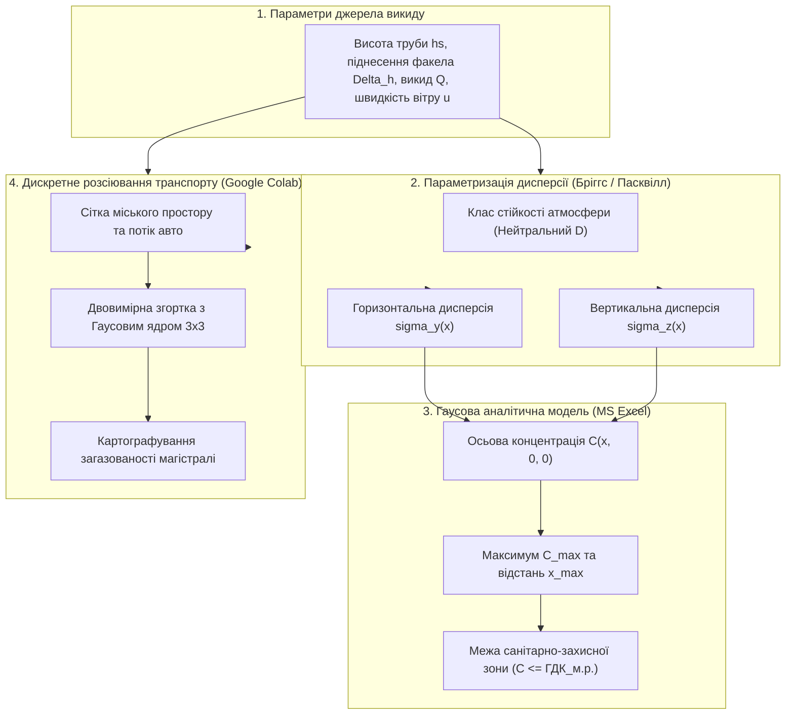

# Лабораторна робота № 6. Комп’ютерне моделювання процесів розсіювання викидів промислових підприємств у атмосферному повітрі на основі гаусової моделі

**Мета:** сформувати систему практичних умінь щодо комп'ютерного моделювання процесів атмосферної дифузії та розсіювання забруднюючих речовин від піднесених промислових і наземних транспортних джерел емісій; опанувати аналітичний апарат розрахунку приземних концентрацій за класичною моделлю Гаусового шлейфу за допомогою табличного процесора Microsoft Excel або Google Таблиці; навчитися визначати координати зони максимального приземного забруднення, оцінювати нормативні межі санітарно-захисної зони (СЗЗ) підприємства та досліджувати просторову динаміку розсіювання вихлопних газів за допомогою дискретної клітинної моделі з Гаусовим ядром у середовищі Google Colab.

---

## Короткі теоретичні відомості

Транспорт і розсіювання забруднюючих речовин у приземному шарі атмосфери є результатом одночасної дії двох фізичних механізмів: спрямованого горизонтального перенесення повітряними масами (адвекції) та стохастичного турбулентного перемішування (дифузії). Для математичного опису поля концентрацій від неперервних піднесених стаціонарних джерел (димових та вентиляційних труб промислових підприємств) фундаментальним стандартом виступає напівемпірична модель Гаусового шлейфу (Gaussian Plume Model). Модель базується на припущенні, що розподіл домішки у площинах, перпендикулярних до напрямку середнього вітру, підпорядковується нормальному (гаусовому) закону розподілу, а відбиття домішки від підстильної земної поверхні є абсолютно пружним без поглинання ґрунтом.

Аналітичний розрахунок об'ємної концентрації речовини $C(x, y, z)$ у довільній просторовій точці з координатами $(x, y, z)$ здійснюється за класичним рівнянням:

$$C(x, y, z) = \frac{Q}{2\pi u \sigma_y(x) \sigma_z(x)} \exp\left( -\frac{y^2}{2\sigma_y^2(x)} \right) \left[ \exp\left( -\frac{(z - H)^2}{2\sigma_z^2(x)} \right) + \exp\left( -\frac{(z + H)^2}{2\sigma_z^2(x)} \right) \right]$$

де змінна $Q$ позначає потужність викиду забруднюючої речовини в атмосферу у грамах за секунду ($\text{г/с}$); величина $u$ визначає середню швидкість вітру на рівні гирла джерела викиду у метрах за секунду ($\text{м/с}$); координата $x$ позначає відстань від джерела за напрямком осі факела (вздовж вітру); координата $y$ відповідає поперечному горизонтальному відхиленню від осі факела; координата $z$ визначає висоту точки спостереження над рівнем земної поверхні; параметр $H$ є ефективною висотою викиду.

Ефективна висота викиду враховує як фізичну геометричну висоту труби $h_s$, так і початкове гідродинамічне та теплове піднесення газоповітряної суміші $\Delta h$, зумовлене швидкістю виходу газів із гирла та температурним градієнтом:

$$H = h_s + \Delta h$$

Для оцінки максимального екологічного навантаження на житлову забудову та визначення меж санітарно-захисної зони розраховують приземну концентрацію безпосередньо на поверхні землі ($z = 0$) вздовж центральної осі шлейфу ($y = 0$):

$$C(x, 0, 0) = \frac{Q}{\pi u \sigma_y(x) \sigma_z(x)} \exp\left( -\frac{H^2}{2\sigma_z^2(x)} \right)$$



Коефіцієнти атмосферної дисперсії $\sigma_y(x)$ та $\sigma_z(x)$ являють собою середньоквадратичні відхилення просторового розподілу домішки у горизонтальному та вертикальному напрямках відповідно. Їхні числові значення нелінійно зростають із віддаленням від труби й залежать від категорії термодинамічної стійкості атмосфери за класифікацією Пасквілла-Гіффорда. У типових умовах міської забудови для нейтрального стану атмосфери (клас стійкості D) розрахунок дисперсійних коефіцієнтів виконується за стандартизованими формулами Бріггса:

$$\sigma_y(x) = 0,16 \cdot x \cdot (1 + 0,0004 \cdot x)^{-0,5}$$

$$\sigma_z(x) = 0,14 \cdot x \cdot (1 + 0,0003 \cdot x)^{-0,5}$$

Точка максимальної приземної концентрації $x_{\max}$ знаходиться на відстані, де вертикальний дисперсійний коефіцієнт сягає величини $\sigma_z(x_{\max}) \approx \frac{H}{\sqrt{2}}$. Відповідно, величина теоретичного максимуму концентрації на поверхні землі становить:

$$C_{\max} \approx \frac{2 Q}{\pi e u H^2} \left( \frac{\sigma_z}{\sigma_y} \right)$$

де константа $e \approx 2,71828$ є основою натурального логарифма.

Поряд із неперервним аналітичним факелом високих джерел, розсіювання низьких емісій від рухомого автотранспорту у щільній міській забудові моделюється за допомогою дискретної клітинної схеми на регулярній сітці. Просторовий перенос описується згорткою матриці концентрацій із дискретним Гаусовим фільтром розмірності $3 \times 3$:

$$\text{gaussian\_kernel} = \begin{bmatrix} 0 & 1 & 0 \\ 1 & 2 & 1 \\ 0 & 1 & 0 \end{bmatrix}$$

Оновлене значення концентрації домішки у кожній клітинці сітки $(i, j)$ на наступному часовому кроці моделювання обчислюється як нормалізована вагома сума поточного вузла та його чотирьох найближчих сусідів:

$$C_{i, j}^{(t+1)} = \frac{2 C_{i, j}^{(t)} + C_{i-1, j}^{(t)} + C_{i+1, j}^{(t)} + C_{i, j-1}^{(t)} + C_{i, j+1}^{(t)}}{6} + \Delta C_{\text{emission}, i, j}$$

де член $\Delta C_{\text{emission}, i, j}$ задає пряме надходження вихлопних газів від автомобілів, що перебувають у даній клітинці у момент часу $t$.

Нормативні санітарно-гігієнічні показники та параметри для оцінки відповідності моделі наведено у наступній довідковій таблиці.

| Параметр моделювання | Умовне позначення | Одиниця вимірювання | Нормативне призначення у розрахунку |
| :--- | :--- | :--- | :--- |
| Потужність викиду джерела | $Q$ | $\text{г/с}$ | Маса забруднювача, що викидається за одиницю часу |
| Фізична висота труби | $h_s$ | $\text{м}$ | Геометрична висота джерела над поверхнею землі |
| Піднесення шлейфу | $\Delta h$ | $\text{м}$ | Теплове та динамічне спливання струменя газів |
| Розрахункова швидкість вітру | $u$ | $\text{м/с}$ | Фактор горизонтального розбавлення та знесення шлейфу |
| Координата максимуму | $x_{\max}$ | $\text{м}$ | Відстань до зони найбільш небезпечного впливу викиду |
| Максимальна приземна концентрація | $C_{\max}$ | $\text{мг/м}^3$ | Пікове забруднення для зіставлення з ГДК максимально разовою |
| Межа санітарно-захисної зони | $x_{\text{СЗЗ}}$ | $\text{м}$ | Відстань, починаючи з якої приземна концентрація $C(x) \le \text{ГДК}_{\text{м.р.}}$ |

> **ВАЖЛИВО:** Величина максимальної приземної концентрації обернено пропорційна квадрату ефективної висоти викиду ($H^2$) та першому степеню швидкості вітру ($u$). Збільшення висоти промислової труби у два рази зменшує пікове приземне забруднення приблизно в чотири рази, проте розширює загальну просторову зону розсіювання шкідливих домішок.

> **ПРАКТИЧНИЙ ЯКІР:** При моделюванні викидів діоксиду азоту вздовж магістралі Крюківського мосту в місті Кременчук дискретна клітинна модель із Гаусовою згорткою підтвердила, що за відсутності стаціонарних промислових джерел у цьому районі саме інтенсивний транспортний потік (понад 3000 автомобілів на добу на 3-смуговій проїзній частині) формує локальну зону екстремальної загазованості, яка за концентраціями перевищує показники сусідніх житлових зон на 40–60%.

> **ТИПОВА ПОМИЛКА:** Розрахунок приземної концентрації на відстанях, надзвичайно близьких до гирла високої труби (наприклад, $x < 50$ м при висоті труби $H = 100$ м), без урахування того, що факел ще не опустився на поверхню землі. На цих відстанях розрахункове значення концентрації за формулою прямує до нуля, що недосвідчені дослідники іноді помилково трактують як абсолютну екологічну чистоту прилеглої території безпосередньо під трубою підприємства.

---

## Порядок виконання роботи

Для виконання завдань використовується вхідний файл `emission_dispersion_parameters.xlsx`, наданий викладачем. Розрахунки класичного Гаусового шлейфу виконуються в середовищі MS Excel або Google Таблиці, а моделювання динамічного транспортного розсіювання — в інтерактивному блокноті Google Colab.

### Етап 1. Завантаження вихідних параметрів промислового джерела
Здобувач відкриває аркуш файлу `emission_dispersion_parameters.xlsx` відповідно до номера свого варіанта. У розрахункову таблицю переносяться значення потужності викиду $Q$, фізичної висоти труби $h_s$, розрахункового піднесення струменя $\Delta h$, швидкості вітру $u$, а також норматив ГДК максимально разової для досліджуваної хімічної сполуки. Обчислюється сумарна ефективна висота джерела $H$.

### Етап 2. Розрахунок дисперсійних коефіцієнтів та концентрації вздовж осі факела
У табличному процесорі формується розрахункова сітка відстаней від джерела $x$ у діапазоні від 100 до 5000 метрів із рівномірним кроком 100 метрів (усього 50 розрахункових точок). За наведеними формулами Бріггса для кожного значення $x$ обчислюються горизонтальний коефіцієнт $\sigma_y(x)$ та вертикальний коефіцієнт $\sigma_z(x)$. В окремому стовпці реалізується формула розрахунку осьової приземної концентрації:
```excel
=(Q / (ПІ() * u * sigma_y * sigma_z)) * EXP(-(H^2) / (2 * sigma_z^2)) * 1000
```
Множник 1000 використовується для переведення результату з $\text{г/м}^3$ у нормативні одиниці $\text{мг/м}^3$.

### Етап 3. Оцінка кратності перевищення нормативів та виявлення екстремуму
У сусідньому стовпці обчислюється кратність ГДК як відношення розрахованої концентрації до нормативу ГДК максимально разової. За допомогою стандартних функцій табличного процесора визначаються максимальне значення концентрації $C_{\max}$ (функція `=MAX`) та точна відстань $x_{\max}$, на якій досягається це пікове значення (за допомогою зв'язки функцій `=INDEX` та `=MATCH`).

### Етап 4. Побудова графіка розсіювання та визначення меж СЗЗ
За розрахованими даними будується точковий графік із плавними лініями, що відображає криву розсіювання $C(x)$ вздовж відстані від джерела. На графік наноситься горизонтальна лінія гранично допустимої концентрації. Здобувач знаходить точку перетину низхідної гілки кривої розсіювання з лінією ГДК, визначаючи нормативну розрахункову межу санітарно-захисної зони $x_{\text{СЗЗ}}$, за межами якої вміст речовини не перевищує гігієнічних нормативів.

### Етап 5. Клітинне моделювання розсіювання автотранспорту в Google Colab
Здобувач переходить до спеціалізованого блокнота Google Colab. У зручній формі графічних віджетів задаються параметри транспортного потоку (кількість автомобілів на магістралі, наявність світлофорів) та швидкість конвективного розсіювання. Запускається розрахунковий блок, який моделює рух автомобілів за алгоритмом A* та розраховує поле приземної загазованості за допомогою матричної згортки з Гаусовим ядром $3 \times 3$. Програма генерує растрову теплову карту розподілу діоксиду азоту над магістраллю міста.

### Етап 6. Порівняльний екологічний аналіз та формування висновків
Здобувач аналізує результати аналітичного Гаусового розрахунку та клітинної симуляції. Формулюється висновок щодо достатності наявної нормативної санітарно-захисної зони підприємства для захисту прилеглих селітебних територій, а також оцінюється частка транспортного навантаження у формуванні загазованості приземного шару повітря.

---

## Індивідуальні завдання

Здобувач обирає свій варіант за наведеною таблицею, знаходить у файлі `emission_dispersion_parameters.xlsx` детальні параметри промислового об'єкта та проводить повний цикл розрахунку розсіювання.

| Варіант | Назва підприємства / об'єкта | Забруднююча речовина | Потужність викиду $Q$, г/с | Висота труби $h_s$, м | Піднесення факела $\Delta h$, м | Розрахункова швидкість вітру $u$, м/с | ГДК максимально разова, $\text{мг/м}^3$ |
| :---: | :--- | :--- | :---: | :---: | :---: | :---: | :---: |
| 1 | Кременчуцький НПЗ (технологічна піч) | Діоксид сірки ($\text{SO}_2$) | 45,0 | 60,0 | 15,0 | 3,5 | 0,500 |
| 2 | Кременчуцька ТЕЦ (котельний цех) | Діоксид азоту ($\text{NO}_2$) | 30,0 | 120,0 | 25,0 | 4,0 | 0,200 |
| 3 | Крюківський вагонобудівний завод | Оксид вуглецю ($\text{CO}$) | 80,0 | 45,0 | 10,0 | 3,0 | 5,000 |
| 4 | ПАТ «Кременчуцький колісний завод» | Пил металевий/недиференційований | 20,0 | 35,0 | 8,0 | 2,5 | 0,500 |
| 5 | Кременчуцький завод технічного вуглецю | Сажа ($\text{C}$) | 12,0 | 50,0 | 12,0 | 3,0 | 0,150 |
| 6 | ПАТ «Укртатнафта» (факельна установка) | Оксид вуглецю ($\text{CO}$) | 120,0 | 80,0 | 30,0 | 5,0 | 5,000 |
| 7 | Залізорудний комбінат (Горішні Плавні) | Пил недиференційований ($\text{Dust}$) | 65,0 | 70,0 | 15,0 | 4,5 | 0,500 |
| 8 | Полтавський ГЗК (випалювальна машина) | Діоксид сірки ($\text{SO}_2$) | 55,0 | 100,0 | 20,0 | 4,0 | 0,500 |
| 9 | Локальна районна котельня міста | Діоксид азоту ($\text{NO}_2$) | 15,0 | 30,0 | 5,0 | 2,0 | 0,200 |
| 10 | Автомагістраль Крюківського мосту | Діоксид азоту ($\text{NO}_2$) | 8,0 | 2,0 (наземне) | 1,0 | 2,5 | 0,200 |

---

## Вимоги до змісту звіту

Звіт оформлюється в електронному вигляді у форматі PDF або DOCX та подається на перевірку викладачу разом із розрахунковою таблицею у форматі XLSX.

Структура звіту повинна містити такі обов'язкові розділи:
1. **Титульна сторінка:** містить найменування навчального закладу, інституту, випускової кафедри, назву навчальної дисципліни, тему лабораторної роботи, номер варіанта індивідуального завдання, а також прізвище, ініціали та навчальну групу здобувача.
2. **Мета роботи:** чітке формулювання дослідницьких і розрахункових цілей відповідно до наданих методичних вказівок.
3. **Порядок виконання роботи:** опис етапів побудови моделі у табличному процесорі із зазначенням використаних формул Бріггса та параметрів налаштування клітинного симулятора в Google Colab.
4. **Результати розрахунків та моделювання:**
   * Зведена розрахункова таблиця параметрів дисперсії $\sigma_y(x), \sigma_z(x)$, приземних концентрацій $C(x, 0, 0)$ та кратності ГДК для відстаней від 100 до 5000 метрів.
   * Графік зміни приземної концентрації вздовж осі шлейфу з нанесеною лінією нормативу ГДК, позначеною точкою максимуму $(x_{\max}, C_{\max})$ та межею санітарно-захисної зони $x_{\text{СЗЗ}}$.
   * Скриншот згенерованої теплової карти загазованості міської магістралі з клітинного симулятора Google Colab.
5. **Аналітичні висновки:** фахова екологічна інтерпретація результатів моделювання; зіставлення розрахункової СЗЗ із нормативними санітарними класифікаціями підприємств; оцінка впливу метеорологічних умов (швидкості вітру) на небезпеку приземного забруднення; рекомендації щодо зниження викидів.
6. **Відповіді на контрольні запитання:** розгорнуті письмові відповіді на всі контрольні запитання, наведені у розділі 5.

---

## 5 Контрольні запитання

1. Які фізичні припущення покладено в основу класичної моделі Гаусового шлейфу, і за яких умов рельєфу та метеорологічного стану атмосфери ці припущення є найбільш адекватними?
2. Яким чином ефективна висота джерела викиду $H$ впливає на абсолютну величину максимальної приземної концентрації $C_{\max}$ та на відстань $x_{\max}$, на якій цей максимум спостерігається?
3. Чому швидкість вітру $u$ входить у знаменник рівняння концентрації Гаусового шлейфу, та за якої критичної швидкості вітру спостерігається найбільше приземне забруднення від високих гарячих промислових викидів?
4. Який екологічний та містобудівний зміст має поняття санітарно-захисної зони (СЗЗ) промислового об'єкта, та як розрахункова крива розсіювання $C(x)$ дозволяє верифікувати її достатність?
5. У чому полягає математична суть моделювання розсіювання викидів автотранспорту за допомогою згортки з Гаусовим ядром на регулярній сітці у порівнянні з класичним аналітичним рівнянням неперервного факела?