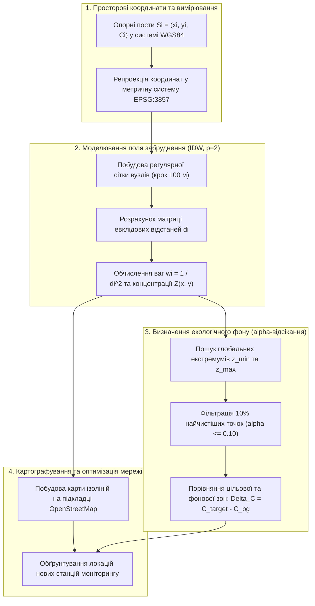

# Лабораторна робота № 7. Геопросторова інтерполяція та картографування розподілу забруднюючих речовин у ГІС-середовищі

**Мета:** сформувати систему практичних умінь щодо застосування геоінформаційних технологій та методів просторового аналізу для моделювання неперервних полів забруднення атмосферного повітря; опанувати математичний алгоритм методу зважених зворотних відстаней (IDW) за допомогою табличного процесора Microsoft Excel або Google Таблиці; навчитися здійснювати репроекцію геопросторових даних із системи географічних координат WGS84 у метричну проекцію EPSG:3857, будувати ізолінії концентрацій на регулярній розрахунковій сітці, визначати просторові зони регіонального екологічного фону за алгоритмом $\alpha$-відсікання та формувати науково обґрунтовані рекомендації щодо розміщення нових вимірювальних постів у середовищі Google Colab без необхідності написання програмного коду.

---

## Короткі теоретичні відомості

Мережі спостереження за якістю атмосферного повітря в урбанізованих регіонах складаються з обмеженої кількості фізичних постів моніторингу через високу вартість прецизійного газоаналітичного обладнання та його технічного обслуговування. Точковий характер первинних замірів формує у міському просторі значні інформаційні «сліпі зони», де інструментальні спостереження відсутні, проте ризики негативного впливу на населення залишаються високими. Для відновлення суцільного поля приземних концентрацій домішок у міжпостовому просторі застосовуються методи геопросторової детермінованої інтерполяції.

Теоретичною основою просторового відновлення даних є Перший закон географії В. Тоблера, який стверджує, що всі просторові об'єкти пов'язані між собою, проте ближчі об'єкти мають більший ступінь взаємного зв'язку, ніж віддалені. Найбільш ефективним та обчислювально стійким методом для умов розріджених міських мереж є метод зважених зворотних відстаней (Inverse Distance Weighting, IDW). Згідно з цим методом, прогнозоване значення концентрації $Z(x, y)$ у довільному неконтрольованому вузлі розрахункової сітки з координатами $(x, y)$ обчислюється як зважене середнє арифметичне значення показників усіх наявних фізичних станцій спостереження:

$$Z(x, y) = \frac{\sum_{i=1}^{N} w_i(x, y) \cdot Z_i}{\sum_{i=1}^{N} w_i(x, y)}$$

де змінна $Z_i$ позначає фактичну виміряну концентрацію забруднюючої речовини на $i$-му фізичному пості спостереження; величина $N$ задає загальну кількість задіяних у розрахунку опорних станцій; функція $w_i(x, y)$ визначає ваговий коефіцієнт впливу $i$-ї станції на цільову розрахункову точку.

Ваговий коефіцієнт є оберненою функцією евклідової відстані між точкою інтерполяції та опорною станцією:

$$w_i(x, y) = \frac{1}{d_i^p} = \frac{1}{\left( \sqrt{(x - x_i)^2 + (y - y_i)^2} \right)^p}$$

де координати $(x_i, y_i)$ визначають просторове положення $i$-ї станції на місцевості; величина $d_i$ позначає геометричну відстань у метрах; параметр $p$ є степенем згладжування (ваговою експонентою). У дослідженнях міського атмосферного забруднення стандартним є значення $p = 2$, що відповідає фізичному закону зменшення інтенсивності поля обернено пропорційно квадрату відстані.



Обов'язковою передумовою коректного застосування методу IDW є приведення просторових координат до єдиної метричної проекції. Первинні дані географічних координат (широта й довгота у системі WGS84, код EPSG:4326) задаються у кутових градусах. Обчислення евклідової відстані за різницею градусів є неприпустимим, оскільки довжина одного градуса довготи суттєво змінюється залежно від широти місцевості. Для забезпечення метричної точності просторові координати обов'язково трансформуються у проекцію Псевдо-Меркатора (WGS 84 / Pseudo-Mercator, код EPSG:3857), у якій одиницею вимірювання є метр.

Після побудови суцільної інтерполяційної поверхні $Z(x, y)$ для оцінки ступеня техногенного навантаження реалізується алгоритм виділення регіональних фонових зон за допомогою критерію $\alpha$-відсікання. Спочатку визначаються абсолютний мінімум та максимум розрахованого концентраційного поля:

$$z_{\min} = \min_{x, y} Z(x, y), \quad z_{\max} = \max_{x, y} Z(x, y)$$

Віртуальна або реальна точка простору класифікується як фонова точка міста, якщо її розрахована концентрація задовольняє умові:

$$Z(x, y) \le z_{\min} + \alpha \cdot (z_{\max} - z_{\min})$$

де параметр $\alpha \in [0; \, 0,10]$ задає граничний рівень фільтрації (відсікання 10% точок із найменшим рівнем забруднення). Середнє значення цієї множини приймається за регіональний екологічний фон $C(x_f, y_f)$.

Для виявлення локальних техногенних аномалій обчислюється різниця між концентрацією у цільовій точці спостереження (наприклад, на завантаженій транспортній розв'язці) та регіональним фоном:

$$\Delta C = C(x_n, y_n) - C(x_f, y_f)$$

Якщо виконується умова $\Delta C > 0$, висувається обґрунтована гіпотеза про наявність неврахованого локального джерела емісій та обґрунтовується необхідність встановлення нового вимірювального поста в зоні максимального градієнта забруднення.

Параметри просторової інтерполяції та картографічні характеристики, що використовуються у розрахунках, зведено у наступній нормативно-методичній таблиці.

| Параметр просторового аналізу | Позначення | Одиниця вимірювання | Нормативне або розрахункове значення | Призначення у моделюванні |
| :--- | :--- | :--- | :--- | :--- |
| Географічна система координат | WGS84 | Градуси | EPSG:4326 | Первинна реєстрація GPS-координат датчиків |
| Проектована система координат | Pseudo-Mercator | Метри | EPSG:3857 | Розрахунок метричних евклідових відстаней |
| Ваговий показник степеня | $p$ | Безрозмірний | $p = 2$ | Визначає швидкість зменшення впливу віддалених постів |
| Крок регулярної розрахункової сітки | $\Delta x, \Delta y$ | Метри | 100 м | Забезпечує оптимальну роздільну здатність карти |
| Параметр відсікання фону | $\alpha$ | Частка | $\alpha = 0,10$ | Виділення 10% найчистіших територій для визначення фону |
| Буферний перекрив колірних зон | $\delta$ | Відсотки | $\pm 10\%$ | Усунення артефактів та розривів між ізолініями |

> **ВАЖЛИВО:** Метод зважених зворотних відстаней є виключно інтерполяційним, а не екстраполяційним методом. Відновлені значення концентрацій за формулою IDW строго обмежені інтервалом між найменшим і найбільшим значеннями, зафіксованими на фізичних станціях ($z_{\min} \le Z(x, y) \le z_{\max}$). Метод не здатен самостійно відтворити екстремальний викид у міжпостовому просторі, якщо цей викид не був зафіксований хоча б одним сусіднім фізичним сенсором.

> **ПРАКТИЧНИЙ ЯКІР:** У муніципальній геоінформаційній системі Кременчука інтерполяція концентрацій формальдегіду за методом IDW на основі чотирьох постів виявила зону стійкого регіонального фону в правобережній житловій частині Крюківського району, водночас на Крюківському мостовому переході розраховане перевищення фону сягнуло $\Delta C = 1,8$ кратності ГДК, що довело домінуючий внесок автомобільного трафіку в забруднення мостового коридору.

> **ТИПОВА ПОМИЛКА:** Розрахунок відстані $d_i$ безпосередньо за різницею кутових десяткових градусів ($\sqrt{(\text{lat}_1 - \text{lat}_2)^2 + (\text{lon}_1 - \text{lon}_2)^2}$) замість метричних координат. Оскільки на широті України довжина одного градуса довготи (близько 72 км) суттєво менша за довжину одного градуса широти (близько 111 км), прямий розрахунок у градусах створює геометричну деформацію просторового поля, штучно витягуючи ізолінії концентрацій у широтному напрямку.

---

## Порядок виконання роботи

Для виконання завдань використовується файл `spatial_air_monitoring_kremenchuk.xlsx`, наданий викладачем. Етап перевірки аналітичного розрахунку IDW для контрольного вузла виконується в табличному процесорі MS Excel або Google Таблиці, а побудова повного інтерполяційного растра, $\alpha$-фільтрація та візуалізація карти на підкладці OpenStreetMap — у блокноті Google Colab.

### Етап 1. Підготовка вихідних координат та показників постів спостереження
Здобувач відкриває аркуш файлу `spatial_air_monitoring_kremenchuk.xlsx` відповідно до номера свого варіанта. У таблицю виписуються номери 4–5 опорних станцій спостереження, їхні географічні координати (широта, довгота), а також заміряні концентрації цільової забруднюючої речовини. Проводиться розрахунок або перевірка метричних координат станцій у системі EPSG:3857 (значення координат $X$ та $Y$ у метрах).

### Етап 2. Ручний розрахунок оцінки IDW для контрольної віртуальної точки в MS Excel
Для глибокого розуміння математичного апарату інтерполяції здобувач обирає одну цільову неконтрольовану точку з відомими координатами $(x_0, y_0)$ та реалізує в електронній таблиці покроковий розрахунок:
* Обчислюються евклідові відстані $d_i$ від цільової точки до кожної опорної станції:
```excel
=SQRT((X_0 - X_i)^2 + (Y_0 - Y_i)^2)
```
* Розраховуються вагові коефіцієнти за законом зворотних квадратів $w_i = \frac{1}{d_i^2}$:
```excel
=1 / (d_i^2)
```
* Обчислюється чисельник $\sum (w_i \cdot Z_i)$, знаменник $\sum w_i$ та результуюча концентрація $Z(x_0, y_0)$.

### Етап 3. Запуск модуля регулярної просторової інтерполяції в Google Colab
Здобувач переходить до хмарного блокнота Google Colab. За допомогою графічного інтерфейсу завантажується вихідний файл варіанта, обирається контрольована домішка та встановлюється крок розрахункової сітки 100 метрів. Програма формує регулярну матрицю вузлів, обчислює концентрацію для кожної клітинки міського простору за алгоритмом IDW ($p = 2$) та виводить значення глобального мінімуму $z_{\min}$ і максимуму $z_{\max}$.

### Етап 4. Картографічна візуалізація ізоліній на підкладці OpenStreetMap
У середовищі Google Colab запускається блок візуалізації, який автоматично підвантажує просторові межі адміністративних районів міста та шар картографічної підкладки OpenStreetMap. Програма будує плавні колірні полігони концентрацій із розширенням меж колірних градієнтів на $\pm 10\%$ для забезпечення безперервного колірного накладання. Червоно-помаранчевими тонами виділяються зони перевищення санітарних норм (більше 1,0 ГДК), а зеленими — безпечні зони.

### Етап 5. Застосування алгоритму $\alpha$-відсікання для визначення фонового полігону
За допомогою інтерактивного повзунка в блокноті здобувач встановлює параметр відсікання $\alpha = 0,10$. Програма автоматично фільтрує 10% вузлів регулярної сітки з найнижчими концентраціями, фарбує їх у бірюзовий колір і наносить поверх основної карти. Здобувач визначає географічне розташування отриманого фонового масиву (назва району, переважаючий тип забудови або природного ландшафту).

### Етап 6. Порівняльний аналіз цільової точки з фоном та вибір місця для нового поста
Здобувач фіксує координати контрольного об'єкта підвищеного ризику (наприклад, мостовий перехід чи перехрестя магістралей) і за розрахованим полем знаходить його концентрацію $C(x_n, y_n)$. Обчислюється перевищення над регіональним фоном $\Delta C$. На основі аналізу отриманого картографічного градієнта та розташування інформаційних «сліпих зон» здобувач визначає точні координати $(X, Y)$ та адресу найбільш доцільного місця для встановлення додаткового автоматичного поста спостереження.

---

## Індивідуальні завдання

Здобувач обирає свій варіант за наведеною таблицею, знаходить у файлі `spatial_air_monitoring_kremenchuk.xlsx` вихідний набір координат та концентрацій і проводить повний цикл просторової інтерполяції та картографування.

| Варіант | Базовий набір станцій спостереження | Забруднююча речовина | Часовий зріз вимірювань | Об'єкт підвищеного ризику (цільова точка) | Цільовий норматив ГДК, $\text{мг/м}^3$ |
| :---: | :--- | :--- | :---: | :--- | :---: |
| 1 | Муніципальні пости № 1, 2, 4, 5 (Кременчук) | Формальдегід ($\text{HCHO}$) | 01.07.2023, 12:00 | Крюківський мостовий перехід | 0,035 (макс. разова) |
| 2 | Муніципальні пости № 1, 2, 4, 5 (Кременчук) | Діоксид азоту ($\text{NO}_2$) | 15.07.2023, 08:00 | Перехрестя вул. Троїцька / Халаменюка | 0,200 (макс. разова) |
| 3 | Муніципальні пости № 1, 2, 4, 5 (Кременчук) | Пил недиференційований ($\text{Dust}$) | 01.08.2023, 15:00 | Залізничний вокзал «Кременчук» | 0,500 (макс. разова) |
| 4 | Станції Vaisala T3950716, T3950713, V0440346 | Діоксид азоту ($\text{NO}_2$) | 15.08.2023, 18:00 | Автомагістраль Київ – Дніпро (М-22) | 0,200 (макс. разова) |
| 5 | Станції Vaisala T3950716, T3950713, V0440346 | Дрібнодисперсний пил ($\text{PM}_{2.5}$) | 01.09.2023, 09:00 | Сквер Бабаєва (центральна зона) | 0,075 (макс. разова) |
| 6 | Станції EcoCity 1748, 1753, 1755, 1756 | Дрібнодисперсний пил ($\text{PM}_{10}$) | 10.09.2023, 14:00 | Житловий масив Молодіжний | 0,150 (макс. разова) |
| 7 | Станції EcoCity 1748, 1753, 1755, 1756 | Оксид вуглецю ($\text{CO}$) | 20.09.2023, 17:00 | Південна прохідна КрАЗ | 5,000 (макс. разова) |
| 8 | Пости № 1, 4 (Кременчук) та Пост № 1 (Г. Плавні) | Діоксид сірки ($\text{SO}_2$) | 01.10.2023, 11:00 | Буферна зона між містами | 0,500 (макс. разова) |
| 9 | Муніципальні пости № 1, 2, 4, 5 (Кременчук) | Оксид вуглецю ($\text{CO}$) | 15.10.2023, 08:00 | Річковий порт Кременчука | 5,000 (макс. разова) |
| 10 | Станції Vaisala T3950716, T3950713 та EcoCity 1756 | Діоксид азоту ($\text{NO}_2$) | 01.11.2023, 19:00 | Дамба Кременчуцького водосховища | 0,200 (макс. разова) |

---

## Вимоги до змісту звіту

Звіт оформлюється в електронному вигляді у форматі PDF або DOCX та подається на перевірку разом із розрахунковою таблицею у форматі XLSX.

Структура звіту повинна містити такі обов'язкові розділи:
1. **Титульна сторінка:** містить найменування навчального закладу, інституту, випускової кафедри, назву навчальної дисципліни, тему лабораторної роботи, номер варіанта індивідуального завдання, а також прізвище, ініціали та навчальну групу здобувача.
2. **Мета роботи:** чітке формулювання дослідницьких і розрахункових цілей відповідно до наданих методичних вказівок.
3. **Порядок виконання роботи:** структурований опис послідовності дій в електронних таблицях та середовищі Google Colab із наведенням розрахункових формул і параметрів перетворення координат.
4. **Результати розрахунків та просторового картографування:**
   * Таблиця координат опорних станцій моніторингу у кутових одиницях WGS84 та метричних значеннях проекції EPSG:3857.
   * Зведена розрахункова таблиця ручного покрокового розрахунку методу IDW для контрольного вузла в MS Excel (відстані, ваги, зважена концентрація).
   * Електронна карта інтерполяційного розподілу забруднення, побудована на географічній підкладці OpenStreetMap із чіткою градацією ізоліній концентрацій.
   * Карта результатів просторової $\alpha$-фільтрації з виділеними точками 10% найчистішого регіонального екологічного фону.
   * Розрахункова оцінка локальної аномалії $\Delta C$ для заданого цільового об'єкта підвищеного техногенного навантаження.
   * Обґрунтування просторових координат (широта, довгота або X, Y у системі EPSG:3857) та топографічної прив'язки рекомендованого місця встановлення нового вимірювального поста.
5. **Аналітичні висновки:** фахове екологічне трактування отриманої просторової картини розсіювання; аналіз виявлених зон екологічного неблагополуччя; оцінка впливу щільності мережі на точність методу IDW; рекомендації для муніципальних органів охорони довкілля.
6. **Відповіді на контрольні запитання:** розгорнуті письмові відповіді на всі контрольні запитання, наведені у розділі 5.

---

## 5 Контрольні запитання

1. У чому полягає фізична та математична суть методу зважених зворотних відстаней (IDW), і як варіювання вагового показника степеня $p$ впливає на форму результуючої інтерполяційної поверхні навколо опорних постів?
2. Чому розрахунок евклідових відстаней між станціями спостереження не можна проводити безпосередньо у географічних кутових координатах WGS84 (EPSG:4326), та яка функціональна роль метричної проекції EPSG:3857 у ГІС-аналізі?
3. Опишіть алгоритм виділення регіонального екологічного фону за допомогою методу $\alpha$-відсікання. Який екологічний зміст має виділення 10% найчистіших віртуальних точок регулярної сітки?
4. Які переваги та фундаментальні обмеження має детермінований метод IDW у порівнянні з геостатистичними методами класу Кригінг (Kriging) під час аналізу сильно розріджених муніципальних систем моніторингу повітря?
5. Яким чином інформація про просторові градієнти забруднення та розташування локальних техногенних аномалій ($\Delta C > 0$) дозволяє оптимізувати схему розміщення нових автоматичних постів моніторингу в місті?