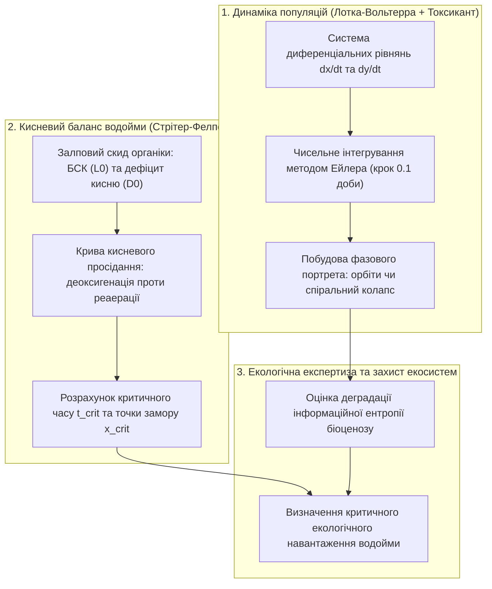

# Лабораторна робота № 8. Моделювання стійкості популяції та оцінка критичних екологічних навантажень за моделлю Лотки-Вольтерра

**Мета:** сформувати систему практичних умінь щодо комп'ютерного моделювання динамічної стійкості біоценозів та процесів самоочищення водних об'єктів в умовах антропогенного навантаження; опанувати метод чисельного інтегрування диференціальних рівнянь міжвидової взаємодії за однокроковою схемою Ейлера в табличному процесорі Microsoft Excel або Google Таблиці; навчитися будувати фазові портрети біосистем, оцінювати критичні пороги токсичного навантаження, що призводять до втрати біологічного різноманіття, а також моделювати просторово-часову динаміку розчиненого кисню при залповому надходженні органічних забруднювачів за моделлю Стрітера-Фелпса за допомогою інтерактивного блокнота Google Colab без потреби самостійного програмування.

---

## Короткі теоретичні відомості

Функціонування природних біологічних угруповань в умовах наростаючого антропогенного впливу визначається складними нелінійними зворотними зв'язками. Забруднення водного середовища важкими металами, нафтопродуктами чи синтетичними поверхнево-активними речовинами змінює фізіологічний стан гідробіонтів, знижує швидкість природного відтворення та викликає токсичну загибель особин. Для дослідження стійкості взаємодіючих біологічних популяцій класичним математичним апаратом виступає система нелінійних диференціальних рівнянь Лотки-Вольтерра («хижак-жертва»), модифікована з урахуванням токсикологічного фактора впливу:

$$\frac{dx}{dt} = \alpha x - \beta x y - \mu_x(C) \cdot x$$

$$\frac{dy}{dt} = \delta x y - \gamma y - \mu_y(C) \cdot y$$

де змінна $x(t)$ позначає щільність популяції жертви (наприклад, рослиноїдного зоопланктону або мирних видів риб); змінна $y(t)$ позначає щільність популяції хижака (наприклад, хижих безхребетних або хижих видів риб); коефіцієнт $\alpha$ характеризує природну питому швидкість розмноження жертви за відсутності хижака; параметр $\beta$ визначає інтенсивність виїдання жертви хижаком при їхніх випадкових зустрічах; коефіцієнт $\delta$ описує ефективність переробки біомаси жертви у відтворення популяції хижака; параметр $\gamma$ відображає коефіцієнт природної смертності хижака; функції $\mu_x(C)$ та $\mu_y(C)$ являють собою коефіцієнти додаткової токсичної смертності особин під дією хімічного забруднювача з концентрацією $C$.

У лінійному токсикологічному наближенні додаткова смертність приймається пропорційною концентрації токсиканта: $\mu(C) = k_{\text{tox}} \cdot C$, де $k_{\text{tox}}$ є коефіцієнтом токсичної чутливості конкретного біологічного виду.



Оскільки аналітичне розв'язання нелінійної системи диференціальних рівнянь у загальному вигляді є складним, у практичних екологічних розрахунках застосовується чисельний метод Ейлера з фіксованим кроком дискретизації часу $\Delta t$ (зазвичай $\Delta t = 0,1$ доби). Розрахункові значення чисельності популяцій на наступному часовому кроці $(t + \Delta t)$ обчислюються за рекурентними співвідношеннями:

$$x_{t + \Delta t} = x_t + \Delta t \cdot \left( \alpha x_t - \beta x_t y_t - k_{\text{tox}, x} \cdot C \cdot x_t \right)$$

$$y_{t + \Delta t} = y_t + \Delta t \cdot \left( \delta x_t y_t - \gamma y_t - k_{\text{tox}, y} \cdot C \cdot y_t \right)$$

Графічний аналіз стійкості системи виконується у фазовому просторі на площині координат $(x, y)$. За відсутності зовнішнього токсичного стресу ($C = 0$) фазова траєкторія являє собою замкнену замкнуту концентричну криву (еліптичну орбіту), що свідчить про нейтральну стійкість і стабільні міжрічні коливання біомаси. У разі зростання концентрації токсиканта понад критичний поріг фазова орбіта розривається і перетворюється на збіжну спіраль, що прямує до нульових значень чисельності хижака, сигналізуючи про біфуркаційний колапс трофічного ланцюга.

Паралельно з аналізом біоценотичних зв'язків критичною екологічною задачею є оцінка стійкості водного об'єкта до катастрофічного надходження легкоокиснюваної органічної речовини (наприклад, унаслідок прориву гідротехнічних споруд, обміління водосховищ або скиду неочищених стічних вод). Динаміка розчиненого у воді кисню описується класичною моделлю кисневого просідання Стрітера-Фелпса (Streeter-Phelps Dissolved Oxygen Sag Model). Модель враховує конкуренцію двох зустрічних процесів: біохімічного споживання кисню мікроорганізмами на деструкцію органічних речовин (константа швидкості деоксигенації $k_1$) та надходження кисню з атмосфери через дзеркало води (константа атмосферної реаерації $k_2$).

Дефіцит розчиненого кисню $D(t)$ у річковому потоці визначається як різниця між рівноважною концентрацією насичення $C_s$ за поточної температури води та фактичною концентрацією розчиненого кисню $C(t)$:

$$D(t) = C_s - C(t) = \frac{k_1 L_0}{k_2 - k_1} \left( e^{-k_1 t} - e^{-k_2 t} \right) + D_0 e^{-k_2 t}$$

де параметр $L_0$ позначає початкову повну біохімічну потребу в кисні (БСК) у створі скиду у міліграмах на дециметр кубічний ($\text{мг/дм}^3$); величина $D_0$ визначає початковий дефіцит розчиненого кисню у вихідному створі; константи $k_1$ та $k_2$ задають швидкості деоксигенації та реаерації у добі у мінус першому степені ($\text{доба}^{-1}$); змінна $t$ позначає час добігання водної маси вниз за течією у добах.

Критичний час $t_{\text{crit}}$, за який дефіцит кисню сягає свого абсолютного максимуму (що відповідає найнижчій концентрації кисню у річці та створює зону масового замору гідробіонтів), розраховується аналітично:

$$t_{\text{crit}} = \frac{1}{k_2 - k_1} \ln\left[ \frac{k_2}{k_1} \left( 1 - \frac{D_0 (k_2 - k_1)}{k_1 L_0} \right) \right]$$

Критична лінійна відстань від місця аварійного скиду до найнебезпечнішого створу річки визначається через швидкість річкової течії $v$:

$$x_{\text{crit}} = v \cdot t_{\text{crit}} \cdot 86400 \cdot 10^{-3}$$

де швидкість $v$ вимірюється в метрах за секунду, а відстань $x_{\text{crit}}$ отримується у кілометрах.

Параметри гідробіологічних та кінетичних моделей стійкості водних об'єктів зведено у наступній довідковій таблиці.

| Параметр екологічної моделі | Умовне позначення | Одиниця вимірювання | Типове значення у водних об'єктах | Екологічний зміст параметра |
| :--- | :--- | :--- | :--- | :--- |
| Природний приріст жертви | $\alpha$ | $\text{доба}^{-1}$ | $0,20 \ldots 0,80$ | Швидкість відновлення кормової біомаси |
| Інтенсивність виїдання | $\beta$ | $(\text{осіб}\cdot\text{доба})^{-1}$ | $0,005 \ldots 0,020$ | Пресорний тиск хижака на жертву |
| Ефективність засвоєння | $\delta$ | $(\text{осіб}\cdot\text{доба})^{-1}$ | $0,001 \ldots 0,008$ | Трофічна трансформація біомаси |
| Природна смертність хижака | $\gamma$ | $\text{доба}^{-1}$ | $0,10 \ldots 0,40$ | Природне відмирання вищих ланок трофічного ланцюга |
| Токсична чутливість | $k_{\text{tox}}$ | $(\text{мг/дм}^3\cdot\text{доба})^{-1}$ | $0,05 \ldots 0,30$ | Вразливість організму до хімічного токсиканта |
| Константа деоксигенації | $k_1$ | $\text{доба}^{-1}$ | $0,10 \ldots 0,35$ | Швидкість окиснення органіки мікрофлорою |
| Константа реаерації | $k_2$ | $\text{доба}^{-1}$ | $0,20 \ldots 0,70$ | Швидкість поглинання кисню через поверхню води |
| Рівноважне насичення $O_2$ | $C_s$ | $\text{мг/дм}^3$ | 9,1 (при 20 °C) | Максимальна природна розчинність кисню |

> **ВАЖЛИВО:** Якщо внаслідок органічного скиду розрахунковий дефіцит кисню $D(t)$ перевищує значення $C_s - 4,0\text{ мг/дм}^3$, залишковий вміст кисню опускається нижче критичної межі $4,0\text{ мг/дм}^3$, що за нормативами рибогосподарського водокористування викликає асфіксію риб та повну деградацію аеробного біоценозу.

> **ПРАКТИЧНИЙ ЯКІР:** Дослідження гідродинамічних наслідків руйнування греблі Каховської ГЕС у 2023 році засвідчили катастрофічне надходження донних мулів із високим вмістом сірководню та легкоокиснюваної органіки, що викликало просідання концентрації розчиненого кисню у придонних горизонтах нижнього Дніпра до $1,5 \ldots 2,0\text{ мг/дм}^3$ та спричинило структурну деградацію іхтіофауни в радіусі десятків кілометрів від епіцентру події.

> **ТИПОВА ПОМИЛКА:** Вибір занадто великого кроку чисельного інтегрування $\Delta t$ у методі Ейлера (наприклад, $\Delta t = 1,0$ доба або більше). Однокроковий метод Ейлера має перший порядок апроксимації, тому при надмірному кроці у розрахунках виникає штучне накопичення чисельної похибки (чисельна нестійкість), що призводить до хибного необмеженого експоненційного зростання популяцій навіть за відсутності реальних екологічних передумов.

---

## Порядок виконання роботи

Для виконання завдань використовується вхідний файл `ecosystem_dynamics_parameters.xlsx`, наданий викладачем. Усі розрахунки чисельної схеми Ейлера та моделі Стрітера-Фелпса реалізуються в електронних таблицях MS Excel або Google Таблиці, а фазові портрети та аналіз ентропії переглядаються у блокноті Google Colab.

### Етап 1. Налаштування параметрів біоценотичної моделі
Здобувач відкриває аркуш файлу `ecosystem_dynamics_parameters.xlsx` відповідно до номера свого варіанта. У розрахункову таблицю виписуються значення демографічних коефіцієнтів $\alpha, \beta, \gamma, \delta$, коефіцієнти токсичної смертності $k_{\text{tox}, x}, k_{\text{tox}, y}$, початкові чисельності популяцій $x_0, y_0$ та концентрація хімічного забруднювача $C$.

### Етап 2. Реалізація однокрокової схеми Ейлера в табличному процесорі
На новому аркуші формується таблиця розрахунку динаміки чисельності популяцій на 365 діб із постійним кроком інтегрування $\Delta t = 0,1$ доби (усього 3651 розрахунковий рядок). У першому рядку записуються початкові значення $x_0$ та $y_0$. Для наступних рядків вводяться рекурентні розрахункові формули Ейлера:
* Чисельність популяції жертви:
```excel
=B2 + $Delta_t * ($alpha * B2 - $beta * B2 * C2 - $k_tox_x * $C * B2)
```
* Чисельність популяції хижака:
```excel
=C2 + $Delta_t * ($delta * B2 * C2 - $gamma * C2 - $k_tox_y * $C * C2)
```
Формули тиражуються на весь діапазон часових кроків.

### Етап 3. Побудова часових діаграм та фазового портрета системи
За отриманими числовими стовпцями будуються два обов'язкові графіки:
* Часова діаграма зміни чисельності жертви $x(t)$ та хижака $y(t)$ протягом року (дві лінії на одній площині).
* Точкова фазова траєкторія у координатах $(x, y)$, де по горизонтальній осі відкладається щільність жертви, а по вертикальній — щільність хижака.
Здобувач візуально оцінює форму фазової орбіти (замкнена еліптична крива свідчить про стабільну природну рівновагу).

### Етап 4. Моделювання токсичного стресу та пошук біфуркаційного колапсу
В окремому експерименті здобувач поступово збільшує значення концентрації забруднювача $C$ із кроком $0,5\text{ мг/дм}^3$. Спостерігається деформація фазового портрета: зміщення центру рівноваги та трансформація замкненої орбіти у збіжну спіраль. Фіксується критична концентрація токсиканта $C_{\text{crit}}$, за якої чисельність популяції хижака $y(t)$ падає нижче порогу виживання ($y < 1\text{ ос/дм}^3$), що означає руйнування трофічного зв'язку.

### Етап 5. Розрахунок кривої кисневого просідання Стрітера-Фелпса
На новому аркуші таблиці здобувач вносить вихідні гідрохімічні параметри річкової системи: початкове органічне навантаження $L_0$, вихідний дефіцит $D_0$, константи $k_1, k_2$, рівноважну концентрацію $C_s = 9,1\text{ мг/дм}^3$ та швидкість течії $v$. Формується часовий інтервал добігання від 0 до 10 діб із кроком 0,2 доби. За наведеною у теоретичних відомостях формулою обчислюється дефіцит кисню $D(t)$ та фактична концентрація розчиненого кисню $C(t) = C_s - D(t)$. За аналітичною формулою обчислюються значення $t_{\text{crit}}$ та критична лінійна відстань $x_{\text{crit}}$ у кілометрах.

### Етап 6. Верифікація результатів та оцінка ентропії в Google Colab
Здобувач переходить до хмарного блокнота Google Colab. У графічній формі вводяться розраховані концентрації та коефіцієнти варіанта. Програма автоматично генерує фазовий портрет системи з вектором фазової швидкості, будує криву кисневого просідання із виділеною червоною зоною замору риби ($C < 4\text{ мг/дм}^3$) та обчислює індекс деградації інформаційної ентропії Шеннона для досліджуваного біоценозу. Здобувач вносить графіки та показники до звіту.

---

## Індивідуальні завдання

Здобувач обирає свій варіант за наведеною таблицею, знаходить у файлі `ecosystem_dynamics_parameters.xlsx` вихідні гідробіологічні константи та проводить повний розрахунковий цикл моделювання стійкості популяцій та кисневого балансу.

| Варіант | Досліджуваний водний об'єкт / ділянка | Модельний біоценоз «жертва – хижак» | Токсикант стресу | Вихідні чисельності $(x_0, y_0)$, ос/дм$^3$ | Початкове БСК $L_0$, $\text{мг/дм}^3$ | Швидкість течії $v$, м/с |
| :---: | :--- | :--- | :--- | :---: | :---: | :---: |
| 1 | Кременчуцьке водосховище (верхів'я) | Дафнії ($\text{Daphnia}$) – Окунь (молодь) | Важкі метали ($\text{Cu}^{2+}$) | (120, 25) | 15,0 | 0,25 |
| 2 | Русло Дніпра (Крюківська протока) | Фітопланктон – Зоопланктон | Нафтопродукти | (350, 40) | 22,0 | 0,45 |
| 3 | Річка Псел (перед гирлом) | Коловертки – Личинки риб | Синтетичні ПАР | (200, 30) | 12,0 | 0,35 |
| 4 | Кам'янське водосховище (буферна зона) | Зоопланктон – Судак (мальки) | Пестициди (атразин) | (180, 20) | 18,0 | 0,20 |
| 5 | Технологічна водойма-охолоджувач ТЕЦ | Фітопланктон – Молюски дрейсени | Фенольні сполуки | (400, 60) | 28,0 | 0,15 |
| 6 | Річка Сула (нижня течія) | Безхребетні бентосу – Короп | Сполуки хрому ($\text{Cr}^{6+}$) | (150, 15) | 10,0 | 0,30 |
| 7 | Дніпро нижче Каховської катастрофи | Річкові раки – Хижі види риб | Сірководень ($\text{H}_2\text{S}$) | (80, 12) | 35,0 | 0,60 |
| 8 | Акваторія Кременчуцького річкового порту | Зоопланктон – Чехоня | Мазутні фракції | (220, 35) | 25,0 | 0,40 |
| 9 | Затока Дніпра (зона скиду очищених вод) | Хлорела – Дафнії | Сполуки нітрогену ($\text{NH}_4^+$) | (500, 50) | 16,0 | 0,10 |
| 10 | Заплавне озеро лівобережжя Дніпра | Фітопланктон – Товстолобик | Органічні токсиканти | (300, 45) | 20,0 | 0,05 |

---

## Вимоги до змісту звіту

Звіт оформлюється в електронному вигляді у форматі PDF або DOCX та подається на перевірку викладачу разом із розрахунковою таблицею у форматі XLSX.

Структура звіту повинна містити такі обов'язкові розділи:
1. **Титульна сторінка:** містить найменування навчального закладу, інституту, випускової кафедри, назву навчальної дисципліни, тему лабораторної роботи, номер варіанта індивідуального завдання, а також прізвище, ініціали та навчальну групу здобувача.
2. **Мета роботи:** чітке формулювання дослідницьких і розрахункових цілей відповідно до наданих методичних вказівок.
3. **Порядок виконання роботи:** структурований опис кроків налаштування розрахункових формул Ейлера та рівнянь Стрітера-Фелпса в електронній таблиці.
4. **Результати розрахунків та моделювання:**
   * Зведена таблиця вихідних констант біодинаміки та гідрохімії варіанта.
   * Графік динаміки чисельності популяцій жертви та хижака за 365 діб за фонових умов ($C = 0$).
   * Фазовий портрет біосистеми у координатах $(x, y)$ для стабільного стану та для умов критичного токсичного навантаження.
   * Зафіксоване значення критичної токсичної концентрації $C_{\text{crit}}$, що спричиняє вимирання хижака.
   * Розрахункова таблиця та графік кривої кисневого просідання Стрітера-Фелпса $D(t)$ і фактичного кисню $C(t)$ із позначенням санітарної межі $4,0\text{ мг/дм}^3$.
   * Аналітичні розрахунки критичного часу $t_{\text{crit}}$ та лінійної відстані до найнебезпечнішого створу $x_{\text{crit}}$ у кілометрах.
   * Скриншот фазового портрета та оцінки інформаційної ентропії Шеннона з інтерфейсу Google Colab.
5. **Аналітичні висновки:** фахове екологічне трактування отриманих динамічних характеристик; аналіз вразливості трофічних ланцюгів досліджуваної водойми до токсичного забруднення; оцінка просторових масштабів кисневого дефіциту та рекомендації щодо локалізації аварійного скиду.
6. **Відповіді на контрольні запитання:** розгорнуті письмові відповіді на всі контрольні запитання, наведені у розділі 5.

---

## 5 Контрольні запитання

1. Які базові екологічні припущення покладено в основу класичної моделі взаємодії біологічних популяцій Лотки-Вольтерра, та яким чином введення токсикологічного фактора впливу змінює топологію фазового простору?
2. У чому полягає суть чисельного методу Ейлера для інтегрування систем диференціальних рівнянь, і чому вибір надмірно великого кроку інтегрування $\Delta t$ викликає чисельну нестійкість розв'язку?
3. Який фізичний та біохімічний зміст мають процеси деоксигенації та атмосферної реаерації в моделі кисневого просідання Стрітера-Фелпса, та як співвідношення констант $k_1$ і $k_2$ визначає глибину кисневої ями?
4. Яким чином аналітичний розрахунок критичного часу $t_{\text{crit}}$ та критичної відстані $x_{\text{crit}}$ дозволяє службам цивільного захисту й моніторингу визначати просторові межі зони масового мору риби при техногенних аваріях на водних об'єктах?
5. Як зміна показника інформаційної ентропії Шеннона корелює зі ступенем антропогенної трансформації гідробіоценозу та втратою видового різноманіття у водних екосистемах?