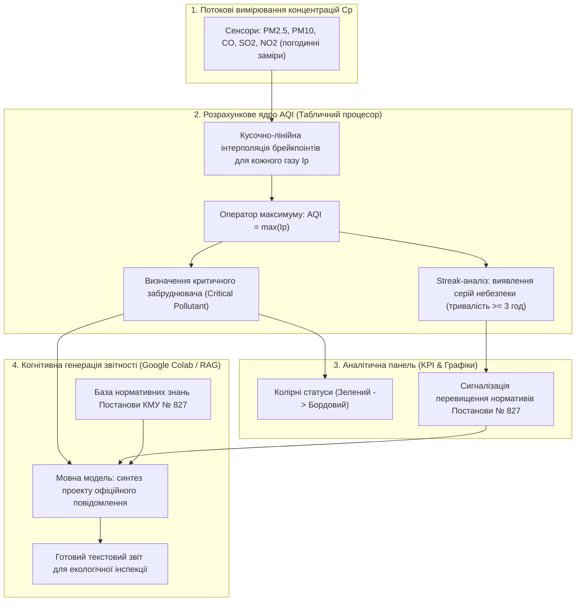

# Лабораторна робота № 9. Розробка аналітичної панелі для розрахунку та візуалізації індексу якості повітря в реальному часі

**Мета:** сформувати систему практичних умінь щодо побудови інформаційно-аналітичних панелей (екологічних дашбордів) та розрахунку інтегральних критеріїв оцінки стану приземного шару атмосфери; опанувати математичний апарат кусочно-лінійної інтерполяції для визначення індексу якості повітря (Air Quality Index, AQI) за концентраційними брейкпоінтами стандарту US EPA в табличному процесорі Microsoft Excel або Google Таблиці; реалізувати алгоритм ідентифікації провідного забруднювача та виявлення небезпечних серій забруднення (streak-аналіз); освоїти методику автоматизованого формування офіційних екологічних звітів за формою Постанови Кабінету Міністрів України № 827 із застосуванням великих мовних моделей і технології генерації, доповненої пошуком (Retrieval-Augmented Generation, RAG), у середовищі Google Colab без необхідності написання програмного коду.

---

## Короткі теоретичні відомості

У системах інформування населення та підтримки прийняття управлінських рішень пряме оперування числовими масивами абсолютних концентрацій багатьох хімічних речовин ускладнює оперативну оцінку екологічної безпеки. Для подолання цього бар'єра у міжнародній практиці застосовується агрегований безрозмірний індекс якості повітря (Air Quality Index, AQI). Індекс приводить гетерогенні вимірювання різнорідних забруднювачів із різними одиницями вимірювання та різними класами токсичності до єдиної стандартизованої шкали від 0 до 500 пунктів, яка однозначно асоціюється з рівнем загрози для здоров'я людини та супроводжується нормативним колірним кодуванням.

Розрахунок індивідуального субіндексу $I_p$ для кожного окремого забруднювача здійснюється за методом кусочно-лінійної інтерполяції на основі нормативної таблиці порогових концентрацій (брейкпоінтів):

$$I_p = \frac{I_{\text{high}} - I_{\text{low}}}{C_{\text{high}} - C_{\text{low}}} \cdot (C_p - C_{\text{low}}) + I_{\text{low}}$$

де параметр $C_p$ позначає фактичну виміряну або згладжену концентрацію $p$-го забруднювача; величини $C_{\text{low}}$ та $C_{\text{high}}$ являють собою нижню та верхню межі концентраційного інтервалу, всередину якого потрапляє значення $C_p$; параметри $I_{\text{low}}$ та $I_{\text{high}}$ визначають відповідні нижню та верхню межі шкали індексу AQI для обраного інтервалу.



Інтегральний індекс якості повітря для комплексу одночасно контрольованих забруднюючих речовин визначається за принципом найгіршого показника за допомогою оператора математичного максимуму:

$$\text{AQI}_{\text{total}} = \max_{p \in \mathcal{P}} \left( I_p \right)$$

де множина $\mathcal{P} = \{\text{PM}_{2.5}, \text{PM}_{10}, \text{CO}, \text{SO}_2, \text{NO}_2\}$ задає перелік контрольованих маркерів. Забруднююча речовина, для якої зафіксовано найвище значення індивідуального субіндексу, автоматично набуває статусу провідного (критичного) забруднювача (Critical Pollutant) для поточного моменту часу, і саме її токсикологічний вплив визначає медичні рекомендації для населення.

Шкала індексу AQI розподілена на шість стандартизованих категорій небезпеки відповідно до чинних міжнародних настанови Всесвітньої організації охорони здоров'я.

| Діапазон AQI | Категорія якості повітря | Колірний код | Рівень загрози для здоров'я населення | Рекомендовані заходи захисту |
| :---: | :--- | :--- | :--- | :--- |
| $0 \ldots 50$ | Добрий (Good) | Зелений | Якість повітря вважається задовільною, забруднення не становить загрози | Обмеження на перебування на відкритому повітрі відсутні |
| $51 \ldots 100$ | Помірний (Moderate) | Жовтий | Якість повітря є прийнятною, проте можливий незначний вплив на надчутливих осіб | Чутливим особам слід обмежити тривалі інтенсивні навантаження на вулиці |
| $101 \ldots 150$ | Шкідливий для чутливих груп | Помаранчевий | Підвищений ризик загострення респіраторних хвороб у дітей, літніх людей та астматиків | Особам із захворюваннями дихальних шляхів обмежити перебування просто неба |
| $151 \ldots 200$ | Шкідливий (Unhealthy) | Червоний | Негативний вплив на здоров'я може відчувати будь-яка людина, для вразливих груп — серйозні наслідки | Рекомендується уникати тривалих фізичних навантажень на відкритому повітрі |
| $201 \ldots 300$ | Дуже шкідливий (Very Unhealthy) | Фіолетовий | Стан тривоги: значне погіршення здоров'я усього міського населення | Усім громадянам рекомендується максимально уникати перебування на вулиці |
| $301 \ldots 500$ | Небезпечний (Hazardous) | Темно-бордовий | Надзвичайна ситуація: гостра токсична дія, висока загроза життю та здоров'ю | Запровадження режиму надзвичайного стану, перебування на вулиці заборонено |

Для розрахунку субіндексів за формулою кусочно-лінійної інтерполяції використовуються нормативні концентраційні брейкпоінти (граничні концентрації), наведені у наступній таблиці стандартів.

| $\text{PM}_{2.5}$, $\text{мкг/м}^3$ (24 год) | $\text{PM}_{10}$, $\text{мкг/м}^3$ (24 год) | $\text{CO}$, $\text{мг/м}^3$ (8 год) | $\text{SO}_2$, $\text{мкг/м}^3$ (1 год) | $\text{NO}_2$, $\text{мкг/м}^3$ (1 год) | $I_{\text{low}} - I_{\text{high}}$ (AQI) | Категорія AQI |
| :---: | :---: | :---: | :---: | :---: | :---: | :--- |
| $0,0 \ldots 12,0$ | $0 \ldots 54$ | $0,0 \ldots 4,4$ | $0 \ldots 35$ | $0 \ldots 53$ | $0 \ldots 50$ | Добрий |
| $12,1 \ldots 35,4$ | $55 \ldots 154$ | $4,5 \ldots 9,4$ | $36 \ldots 75$ | $54 \ldots 100$ | $51 \ldots 100$ | Помірний |
| $35,5 \ldots 55,4$ | $155 \ldots 254$ | $9,5 \ldots 12,4$ | $76 \ldots 185$ | $101 \ldots 360$ | $101 \ldots 150$ | Для чутливих груп |
| $55,5 \ldots 150,4$ | $255 \ldots 354$ | $12,5 \ldots 15,4$ | $186 \ldots 304$ | $361 \ldots 649$ | $151 \ldots 200$ | Шкідливий |
| $150,5 \ldots 250,4$ | $355 \ldots 424$ | $15,5 \ldots 30,4$ | $305 \ldots 604$ | $650 \ldots 1249$ | $201 \ldots 300$ | Дуже шкідливий |
| $250,5 \ldots 500,4$ | $425 \ldots 604$ | $30,5 \ldots 50,4$ | $605 \ldots 1004$ | $1250 \ldots 2049$ | $301 \ldots 500$ | Небезпечний |

Відповідно до Постанови КМУ № 827, оперативне реагування вимагає фіксації не поодиноких сплесків, а тривалих періодів підвищеного забруднення. З цією метою у розрахунковій системі налаштовується алгоритм streak-аналізу, який рахує тривалість безперервної послідовності годин, під час яких $\text{AQI}_{\text{total}} \ge 101$. Якщо лічильник серії сягає критичного порогу $K = 3$ години, система ініціює оповіщення та передає агреговані параметри до аналітичного блоку формування звіту.

Для автоматизації складання звітної документації застосовується концепція когнітивного аналізу даних на базі великих мовних моделей (LLM) з архітектурою RAG. Технологія RAG дозволяє мовній моделі використовувати не загальні текстові шаблони, а точні положення нормативно-правових актів України та регламенти Постанови № 827, що виключає фактологічні помилки та забезпечує генерацію юридично грамотного звіту безпосередньо з числових табличних масивів.

> **ВАЖЛИВО:** Під час розрахунку кусочно-лінійного субіндексу концентрації речовин перед підстановкою у формулу підлягають попередньому усіченню (округленню) до встановленої точності стандарту: пил PM2.5 округлюється до десятих часток ($0,1\text{ мкг/м}^3$), оксид вуглецю — до десятих часток ($0,1\text{ мг/м}^3$), а для PM10, діоксиду сірки та діоксиду азоту значення усікаються до цілих чисел. Округлення результуючого значення субіндексу $I_p$ завжди виконується до найближчого цілого числа.

> **ПРАКТИЧНИЙ ЯКІР:** В інформаційно-аналітичній системі муніципального моніторингу міста Кременчук розроблено веб-сервіс, де за даними станцій Vaisala в автоматичному режимі формуються інтерактивні шкали AQI та реалізовано автоматичне генерування офіційних звітів у форматі документів MS Word для надання до органів Міністерства захисту довкілля та природних ресурсів України при фіксації 3-годинних перевищень нормативів.

> **ТИПОВА ПОМИЛКА:** Спроба обчислення інтегрального індексу AQI як середнього арифметичного значення індивідуальних субіндексів окремих речовин. Такий підхід категорично неприпустимий, оскільки усереднення маскує смертельну небезпеку: наприклад, якщо субіндекс діоксиду азоту дорівнює 350 (надзвичайна небезпека), а решта чотирьох речовин мають показники близько 20 (чисте повітря), середнє значення складе 86 (помірний рівень), що дезінформує органи управління та загрожує життю громадян.

---

## Порядок виконання роботи

Для виконання завдань використовується вхідний файл `aqi_monitoring_kremenchuk.xlsx`, наданий викладачем. Усі розрахунки кусочно-лінійних інтерполяцій, оператора максимуму та streak-аналізу реалізуються в електронних таблицях MS Excel або Google Таблиці, а генерація проекту звіту на базі LLM/RAG — у хмарному блокноті Google Colab.

### Етап 1. Ознайомлення з масивом погодинних спостережень
Здобувач відкриває аркуш файлу `aqi_monitoring_kremenchuk.xlsx` відповідно до номера свого варіанта. У вибірці представлено добовий масив погодинних вимірювань (24 часові точки) за п'ятьма обов'язковими забруднюючими речовинами: $\text{PM}_{2.5}$, $\text{PM}_{10}$, $\text{CO}$, $\text{SO}_2$ та $\text{NO}_2$. Проводиться візуальний контроль розмірностей: концентрації газів та пилу звіряються з одиницями нормативної таблиці брейкпоінтів.

### Етап 2. Реалізація розрахунку субіндексів за кусочно-лінійною формулою
В електронній таблиці створюються п'ять розрахункових стовпців для визначення індивідуальних субіндексів $I_{\text{PM2.5}}, I_{\text{PM10}}, I_{\text{CO}}, I_{\text{SO2}}, I_{\text{NO2}}$. Розрахунок реалізується за допомогою функції багатоваріантної перевірки умов `=IFS` (або вкладених функцій `=ЯКЩО`), де для кожного концентраційного діапазону речовини прописується відповідна формула лінійної інтерполяції з таблиці теоретичних відомостей:
```excel
=IFS(B2<=12; (50/12)*B2; B2<=35,4; ((100-51)/(35,4-12,1))*(B2-12,1)+51; ...)
```
Розраховані значення субіндексів округлюються до цілих чисел за допомогою функції `=ROUND(..., 0)`.

### Етап 3. Визначення інтегрального індексу AQI та провідного забруднювача
У сусідньому розрахунковому стовпці обчислюється підсумковий показник $\text{AQI}_{\text{total}}$ для кожної години доби за допомогою функції пошуку максимуму:
```excel
=MAX(G2:K2)
```
В окремому стовпці визначається назва провідного забруднювача (Critical Pollutant) за допомогою зв'язки пошукових функцій:
```excel
=INDEX($G$1:$K$1; MATCH(L2; G2:K2; 0))
```
де клітинка `L2` містить розрахований максимальний AQI, а діапазон `$G$1:$K$1` містить текстові назви стовпців субіндексів.

### Етап 4. Налаштування умовного колірного форматування та індикатора тривоги
Для стовпця інтегрального індексу налаштовується умовне форматування клітинок відповідно до нормативної колірної шкали (зелений для $0 \ldots 50$, жовтий для $51 \ldots 100$, помаранчевий для $101 \ldots 150$, червоний для $151 \ldots 200$, фіолетовий для $201 \ldots 300$, бордовий для $301 \ldots 500$). Додається стовпець бінарного індикатора перевищення безпечного порогу:
```excel
=ЯКЩО(L2 >= 101; 1; 0)
```

### Етап 5. Реалізація рекурентного streak-аналізу тривалості небезпеки
В окремому стовпці `Streak_Hours` реалізується накопичувальний лічильник послідовних годин підвищеного забруднення. Для першого рядка вводиться значення бінарного індикатора, а для наступних рядків прописується рекурентна функція накопичення:
```excel
=ЯКЩО(N3=1; O2+1; 0)
```
де клітинка `N3` є поточним індикатором перевищення, а клітинка `O2` — попереднім значенням лічильника серії. За допомогою функції `=COUNTIF(O:O; ">=3")` фіксується факт виникнення критичної ситуації за нормативами Постанови № 827. Будується графік погодинної динаміки $\text{AQI}_{\text{total}}$ із сигнальною горизонтальною лінією порогу 100 пунктів.

### Етап 6. Автоматизована генерація офіційного звіту через LLM/RAG у Google Colab
Здобувач переходить до хмарного блокнота Google Colab. У форму введення вносяться підсумкові розрахункові метрики за добу: максимальний зареєстрований індекс $\text{AQI}_{\text{total}}$, назва критичного забруднювача, тривалість найдовшої безперервної серії перевищення у годинах, а також дата та адреса спостережного поста. Запускається готовий скрипт, який за допомогою технології RAG зіставляє отримані показники зі статтею Постанови КМУ № 827 і генерує проект офіційного повідомлення до територіального органу екологічної інспекції. Здобувач копіює згенерований текст до аналітичного звіту.

---

## Індивідуальні завдання

Здобувач обирає номер індивідуального варіанта за наведеною таблицею, знаходить у файлі `aqi_monitoring_kremenchuk.xlsx` відповідний добовий масив погодинних спостережень та проводить повний розрахунковий цикл аналізу індексу AQI і генерації офіційного звіту.

| Варіант | Станція спостереження / адреса | Характер функціональної зони | Дата добового аналізу | Пріоритетні сенсорні маркери | Критичний поріг реагування ($K$) |
| :---: | :--- | :--- | :---: | :--- | :---: |
| 1 | Пост № 1 (вул. Молодіжна, 9) | Промислово-селітебна зона | 12.07.2023 | $\text{PM}_{2.5}, \text{PM}_{10}, \text{CO}, \text{NO}_2, \text{SO}_2$ | $\ge 3$ год при $\text{AQI} \ge 101$ |
| 2 | Пост № 2 (вул. Богаєвського) | Транспортний перетин доріг | 18.07.2023 | $\text{PM}_{2.5}, \text{PM}_{10}, \text{CO}, \text{NO}_2, \text{SO}_2$ | $\ge 3$ год при $\text{AQI} \ge 101$ |
| 3 | Пост № 4 (вул. Шевченка, 22/30) | Центральна міська забудова | 25.07.2023 | $\text{PM}_{2.5}, \text{PM}_{10}, \text{CO}, \text{NO}_2, \text{SO}_2$ | $\ge 3$ год при $\text{AQI} \ge 101$ |
| 4 | Пост № 5 (вул. І. Приходька, 89) | Привокзальна промислова зона | 05.08.2023 | $\text{PM}_{2.5}, \text{PM}_{10}, \text{CO}, \text{NO}_2, \text{SO}_2$ | $\ge 3$ год при $\text{AQI} \ge 101$ |
| 5 | Vaisala T3950716 (Північний вузол) | Важка нафтохімічна індустрія | 14.08.2023 | $\text{PM}_{2.5}, \text{PM}_{10}, \text{CO}, \text{NO}_2, \text{SO}_2$ | $\ge 3$ год при $\text{AQI} \ge 101$ |
| 6 | Vaisala T3950713 (Район «Фаворит») | Торговельно-транспортний вузол | 22.08.2023 | $\text{PM}_{2.5}, \text{PM}_{10}, \text{CO}, \text{NO}_2, \text{SO}_2$ | $\ge 3$ год при $\text{AQI} \ge 101$ |
| 7 | Vaisala V0440346 (Гімназія № 26) | Спальний мікрорайон, школа | 02.09.2023 | $\text{PM}_{2.5}, \text{PM}_{10}, \text{CO}, \text{NO}_2, \text{SO}_2$ | $\ge 3$ год при $\text{AQI} \ge 101$ |
| 8 | EcoCity 1748 (вул. Соборна) | Пішохідна зона центра міста | 11.09.2023 | $\text{PM}_{2.5}, \text{PM}_{10}, \text{CO}, \text{NO}_2, \text{SO}_2$ | $\ge 3$ год при $\text{AQI} \ge 101$ |
| 9 | EcoCity 1756 (Крюківський міст) | Вузьке горло мостової магістралі | 20.09.2023 | $\text{PM}_{2.5}, \text{PM}_{10}, \text{CO}, \text{NO}_2, \text{SO}_2$ | $\ge 3$ год при $\text{AQI} \ge 101$ |
| 10 | Пост № 1 (м. Горішні Плавні) | Гірничо-збагачувальний комбінат | 28.09.2023 | $\text{PM}_{2.5}, \text{PM}_{10}, \text{CO}, \text{NO}_2, \text{SO}_2$ | $\ge 3$ год при $\text{AQI} \ge 101$ |

---

## Вимоги до змісту звіту

Звіт оформлюється в електронному вигляді у форматі PDF або DOCX та подається на перевірку викладачу разом із розрахунковою таблицею у форматі XLSX.

Структура звіту повинна містити такі обов'язкові розділи:
1. **Титульна сторінка:** містить найменування навчального закладу, інституту, випускової кафедри, назву навчальної дисципліни, тему лабораторної роботи, номер варіанта індивідуального завдання, а також прізвище, ініціали та навчальну групу здобувача.
2. **Мета роботи:** чітке формулювання дослідницьких і розрахункових цілей відповідно до наданих методичних вказівок.
3. **Порядок виконання роботи:** структурований опис послідовності обчислювальних кроків у табличному процесорі із зазначенням використаних формул кусочно-лінійної інтерполяції та алгоритму streak-аналізу.
4. **Результати розрахунків та аналітична панель:**
   * Зведена розрахункова таблиця за 24 години, що містить значення фактичних концентрацій, індивідуальних субіндексів для 5 речовин, інтегрального $\text{AQI}_{\text{total}}$, назви провідного забруднювача та показників лічильника серії небезпеки.
   * Кольорове оформлення стовпця $\text{AQI}_{\text{total}}$ відповідно до стандартизованої шкали небезпеки.
   * Графік погодинної динаміки індексу AQI з нанесеною сигнальною лінією порогу 100 пунктів та виділеною зоною небезпечної неперервної серії ($\ge 3$ годин).
   * Повний текст офіційного аналітичного звіту за формою Постанови КМУ № 827, згенерований мовною моделлю в середовищі Google Colab.
5. **Аналітичні висновки:** фахове екологічне трактування добового стану якості повітря; характеристика виявленого провідного забруднювача та ймовірних джерел його генерації; оцінка своєчасності детектування небезпечної події за допомогою streak-аналізу; рекомендації для муніципалітету щодо регулювання транспортних або промислових викидів.
6. **Відповіді на контрольні запитання:** розгорнуті письмові відповіді на всі контрольні запитання, наведені у розділі 5.

---

## 5 Контрольні запитання

1. Які переваги та обмеження має використання інтегрального індексу якості повітря (AQI) у порівнянні з прямим зіставленням фактичних концентрацій забруднювачів із нормативами гранично допустимих концентрацій?
2. Опишіть математичний алгоритм кусочно-лінійної інтерполяції субіндексів за формулою US EPA. Чому для кожного забруднювача встановлено індивідуальні концентраційні діапазони брейкпоінтів?
3. Чому інтегральний індекс якості повітря для багатокомпонентного середовища визначається виключно за оператором математичного максимуму $\text{AQI} = \max(I_p)$, а не за формулою середнього арифметичного значення?
4. Який нормативний та екологічний зміст має виявлення безперервних серій підвищеного забруднення тривалістю три години поспіль і більше (streak-аналіз) у контексті вимог Постанови Кабінету Міністрів України № 827?
5. У чому полягає принципова відмінність технології пошуково-доповненої генерації (Retrieval-Augmented Generation, RAG) від звичайного використання великих мовних моделей під час автоматизації підготовки офіційних екологічних звітів?